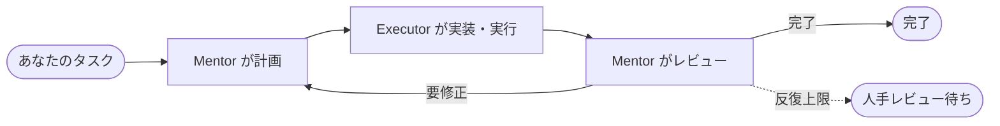

<!-- prettier-ignore -->
<div align="center">


# The Pair

**ひとつのタスクに 2 つの AI エージェント。片方がコードを書き、もう片方がレビューする。**

デスクトップで動くオープンソースの AI ペアプログラミング。読み取り専用の **Mentor** が計画とレビューを、
**Executor** がコードの記述とコマンドの実行を担当し、互いの作業をチェックしてから
コードベースに届けます。_（そう、The Pair は The Pair で作られました。）_

[](https://github.com/timwuhaotian/the-pair/releases)
[](https://github.com/timwuhaotian/the-pair/releases)
[](https://github.com/timwuhaotian/the-pair/actions)
[](LICENSE)
[](https://github.com/timwuhaotian/the-pair/stargazers)

[English](README.md) · [简体中文](README.zh.md) · **日本語** · [한국어](README.ko.md)

[**⬇ ダウンロード**](https://github.com/timwuhaotian/the-pair/releases) &nbsp;·&nbsp; [**クイックスタート**](#クイックスタート) &nbsp;·&nbsp; [**CLI**](https://github.com/timwuhaotian/pair-code) &nbsp;·&nbsp; [**ウェブサイト**](https://apps.timwuhaotian.dev/)

<sub>macOS · Windows · Linux</sub>

<br />


<sub>完了した実行：Mentor が計画し、Executor が実装し、Mentor が diff を読んで承認しました。</sub>

</div>

<br />

## なぜエージェントが 2 つなのか

コードを書いたモデルに自分のコードをレビューさせると、たいてい自分に同意します。The Pair はこの仕事を 2 つに分け、別々のエージェントに — お望みなら別々のモデルに — 任せます。

| ロール       | すること                                             | 触れられる範囲                 |
| ------------ | ---------------------------------------------------- | ------------------------------ |
| **Mentor**   | コードを読み、計画を書き、すべての結果をレビューする | 読み取り専用                   |
| **Executor** | コードを書き、コマンドを実行し、検証して結果を返す   | その Pair のワークスペースのみ |



実行は、Mentor が完了を告げるか、あなたが止めるまで続きます。Pair に反復上限を設定しておくと、上限に達した時点で一時停止してレビューを待つので、続行・モデルの変更・終了を選べます。作業中はコーヒーでも飲みに行ってください — もちろん、その場で舵を取ることもできます。ターンを止める、フィードバックを送る、1 行も書かれる前に計画を承認する、いずれも可能です。

### 比較

| 機能                         | The Pair                        | Cursor / Copilot      | Claude Code（単独）   |
| ---------------------------- | ------------------------------- | --------------------- | --------------------- |
| エージェント間の相互検証     | ✅ 独立した 2 エージェント      | ❌ 単一エージェント   | ❌ 単一エージェント   |
| レビュー専任ロール           | ✅ Mentor（読み取り専用）       | ❌ セルフレビューのみ | ❌ セルフレビューのみ |
| マルチプロバイダー           | ✅ 任意のモデルエンドポイント   | ❌ 1 社に固定         | ❌ Claude のみ        |
| ローカルオーケストレーション | ✅ 完全ローカル                 | ❌ クラウド依存       | ❌ クラウド依存       |
| セッション復元               | ✅ スナップショットから完全復元 | ❌                    | ❌                    |
| オープンソース               | ✅ Apache 2.0                   | ❌ プロプライエタリ   | ❌ プロプライエタリ   |

## ひとめぐり

<table>
  <tr>
    <td width="50%" valign="top">
      
      <br />
      <b>ターンをリアルタイムで見る</b><br />
      <sub>Executor の読み取り、編集、コマンドがすべてライブで見え、停止ボタンもすぐそこに。</sub>
    </td>
    <td width="50%" valign="top">
      
      <br />
      <b>すべての Pair をひとつのハブに</b><br />
      <sub>ステータス、反復、ブランチがひと目でわかり、中断されたセッションは復元を提案します。</sub>
    </td>
  </tr>
  <tr>
    <td width="50%" valign="top">
      
      <br />
      <b>自分のモデルを持ち込む</b><br />
      <sub>エンドポイント、アカウント、認証情報を一か所で管理。エージェント CLI のインストールは不要です。</sub>
    </td>
    <td width="50%" valign="top">
      
      <br />
      <b>⌘K ですべてを</b><br />
      <sub>あらゆる操作をあいまい検索できるパレット。任意の Pair へ直接ジャンプできます。</sub>
    </td>
  </tr>
</table>

## 機能

**ループ**

- **デュアルエージェントアーキテクチャ** — 計画とレビュー（Mentor）を実行（Executor）から分離
- **スマートな協調** — 構造化された引き継ぎプロンプト、品質ゲート、スマートポーズが反復を的確に保つ
- **受け入れチェック** — Mentor がテストや lint を実行し、リスク・根拠・次のステップを添えた判定を返す
- **計画ゲートと反復上限** — 最初の計画を自分で承認することも、Pair ごとに反復上限を設けることも可能（既定では無制限）
- **停滞検出** — 出力が 120 秒ないと警告、600 秒で停滞と判定

**コンソール**

- **ひとつのセッションコンソール** — タスク、計画、結果、レビュー、ライブのターンを 1 本のスクロールフィードに集約。検索とロール別フィルター付き
- **認知イベントストリーム** — ターンごとのインテントチップ、推論ステップ、ツール呼び出しの状態
- **使用量の追跡** — ターンごと・実行ごとのトークン、推定コスト、リクエスト数、最終出力
- **インスペクター** — モデル、実行状態、使用量、ファイル、履歴、タイムラインを折りたたみ可能なセクションで表示
- **アクティビティとインサイト** — 全 Pair のうち対応が必要なもの、そしてうまくいったモデルの組み合わせ

**あなたのリポジトリ**

- **Git 変更追跡** — ベースラインコミットに対する追加・変更・削除ファイルを、それぞれインライン diff 付きで表示
- **ワークツリー** — タスクごとに専用の git worktree と `the-pair/…` ブランチで実行し、インスペクターからコミットとプッシュまで
- **スキルとメンション** — `/skill` でプロジェクトのスキルファイルを、`@path` でファイルを添付
- **セッション復元** — 実行中にスナップショットを保存。中断したセッションは履歴とターンの状態ごと戻せます

**モデル**

- **エンドポイントは持ち込み** — 他のエージェントの設定（opencode、codex、claude、kimi、pi、omp、gemini、killi）をインポート、キーを手動で追加、または ChatGPT・Command Code・OpenCode Go・Muse Code のサブスクリプションでサインイン
- **どのモデルもどちらのロールにも** — Mentor と Executor それぞれに、エンドポイント、モデル、推論の強さを個別に選択
- **ローカルオーケストレーション** — アプリも協調処理も手元のマシンで動作。モデル呼び出しは選んだエンドポイントかローカルモデルへ直接送られます

**アプリ**

- **コマンドパレットとショートカット** — あらゆる操作に届く ⌘K、グローバルショートカット、ネイティブのメニューバー
- **4 つの言語** — English、简体中文、日本語、한국어
- **ライト／ダークテーマ**、一括ミュートできるサウンド通知、アプリ内アップデート

## インストール

[GitHub Releases](https://github.com/timwuhaotian/the-pair/releases) から最新版をダウンロードしてください：

| プラットフォーム | ファイル                                                         |
| ---------------- | ---------------------------------------------------------------- |
| **macOS**        | `the-pair-{version}.zip`                                         |
| **Windows**      | `the-pair-{version}-setup.exe`                                   |
| **Linux**        | `the-pair-{version}.AppImage.tar.gz`（展開して AppImage を実行） |

ターミナル派ですか？ **CLI** ユーザーは、The Pair のターミナル版 [Pair Code](https://github.com/timwuhaotian/pair-code) を [npm](https://www.npmjs.com/package/pair-code) からインストールできます：

```bash
npm install -g pair-code
```

| インターフェース | 向いている用途                                | ここから                                                                     |
| ---------------- | --------------------------------------------- | ---------------------------------------------------------------------------- |
| **デスクトップ** | 視覚的な監視、インストーラー、長時間動く Pair | [The Pair をダウンロード](https://github.com/timwuhaotian/the-pair/releases) |
| **CLI**          | ターミナル中心の作業、スクリプト、SSH         | [Pair Code](https://github.com/timwuhaotian/pair-code)                       |

<details>
<summary><b>ソースからビルド</b></summary>

<br />

```bash
git clone https://github.com/timwuhaotian/the-pair.git
cd the-pair
npm install
npm run build:mac  # または build:win / build:linux
```

macOS では、`build:mac` がローカル用の DMG を、`build:mac:release` が GitHub Releases で使う ZIP バンドルを生成します。ビルドスクリプトは Tauri を呼び出す前に必要な Rust ターゲットをインストールします。自分でセットアップする場合：

```bash
rustup target add aarch64-apple-darwin x86_64-apple-darwin
```

</details>

## クイックスタート

> [!NOTE]
> The Pair には、認証情報のあるモデルエンドポイントが 1 つ必要です。モデルとは HTTPS で直接通信します — エージェント CLI のインストールは不要です。

**1. モデルを接続する。** 左レールの **モデル** を開き、次のいずれかの方法でエンドポイントを追加します：

- **agent をスキャン** — 他のエージェントが既に持っているエンドポイントとキー（kimi、pi、omp、opencode、codex、claude、gemini、killi）、または環境変数のものをインポート
- **エンドポイントを追加** — プロトコル、ベース URL、API キー、モデル ID を入力
- **サインイン** — ChatGPT、Command Code、OpenCode Go、Muse Code のサブスクリプションをアプリ内で認可

使える認証情報がないエンドポイントも、何が妨げになっているかとともに一覧に表示されます。

**2. Pair を作成する。** **新しいペア** をクリックし、ディレクトリを選んでタスクを書き、Mentor と Executor それぞれのエンドポイント、モデル、推論の強さを選びます。

**3. 見守る。あるいは見守らない。** Mentor が計画し、Executor が実装し、Mentor がレビューします。コンソールで追いかけ、好きなときに介入し、終わったら変更ファイルを確認してください。

> [!TIP]
> 完全にオフラインで使うなら、[Ollama](https://ollama.com) 経由のローカルモデルをどうぞ。

## 設定

**認証情報** は、アプリのデータディレクトリにあるアプリ独自のストア `credentials.json`（モード 0600）に保存されます。他のエージェントの設定や環境変数を読むインポーターは読み取るだけで、書き戻すことはありません。

**Pair ランタイム。** 各 Pair は、選んだディレクトリで直接作業するか、専用の git worktree と `the-pair/…` ブランチで作業します。セッションの状態 — スナップショット、実行レポート、実行をまたぐインテリジェンスストア — はアプリのデータディレクトリに置かれ、リポジトリの中には決して書き込まれません。

> [!NOTE]
> エージェントのツールはアプリ内で動き、その Pair のワークスペースに限定されます。Mentor は常に読み取り専用です。

## アーキテクチャ

Tauri 2 アプリです。Rust のバックエンドが HTTPS でモデルエンドポイントと通信してエージェントのツールを実行し、React のフロントエンドが会話と操作系を描画します。

| レイヤー           | 中身                                                                                                                    |
| ------------------ | ----------------------------------------------------------------------------------------------------------------------- |
| **フロントエンド** | React 19 + TypeScript、Tailwind CSS v4、Zustand、Framer Motion — Pairs ハブ、セッションコンソール、インスペクター       |
| **ブリッジ**       | Tauri IPC                                                                                                               |
| **バックエンド**   | Rust — Pair のライフサイクル、ターンのステートマシン、応答をストリーミングしてツールを実行するハーネス                  |
| **モデル**         | ワイヤプロトコルごとのストリーミングクライアント（OpenAI Chat、Anthropic、Responses、Command Code）と認証情報レジストリ |
| **Git**            | ベースラインコミットに対する変更追跡、ワークツリー、セッションスナップショット                                          |

```
Idle → Mentoring → Executing → Reviewing → (loop | Finished | Paused | Awaiting Human Review | Error)
```

モジュールの全体像は `AGENTS.md` にあります。

## 開発

**Node.js 22.22+**、**Git**、そしてデスクトップビルドには **Rustup** が必要です。

```bash
git clone https://github.com/timwuhaotian/the-pair.git
cd the-pair
npm install
npm run preflight   # ツールチェーンを確認
npm run dev         # ホットリロード付きでアプリを起動
npm run dev:mock    # 同じく起動。ただし定型のターンを使い、モデルは呼び出さない
```

<details>
<summary><b>すべてのスクリプト</b></summary>

<br />

| コマンド                    | 説明                                            |
| --------------------------- | ----------------------------------------------- |
| `npm run dev`               | ホットリロード付きでアプリを起動                |
| `npm run dev:mock`          | モックのエージェントでアプリを起動              |
| `npm run dev:smoke`         | スモークテストモードでアプリを起動              |
| `npm run preflight`         | ローカルのビルド前提条件を確認                  |
| `npm test`                  | JavaScript・コンポーネント・Rust のテストを実行 |
| `npm run test:js`           | Node/TypeScript のユニットテストを実行          |
| `npm run test:ui`           | コンポーネントテストを実行                      |
| `npm run test:rust`         | Rust のテストを実行                             |
| `npm run typecheck`         | TypeScript の型をチェック                       |
| `npm run lint`              | ESLint を実行                                   |
| `npm run format`            | Prettier でフォーマット                         |
| `npm run e2e:web`           | モック IPC に対するヘッドレス E2E テストを実行  |
| `npm run e2e:setup`         | Appium の macOS ドライバーをインストール        |
| `npm run e2e`               | macOS でモック E2E テストを実行                 |
| `npm run clean`             | 生成されたビルド成果物を削除                    |
| `npm run build:mac`         | ローカル用の macOS DMG をビルド                 |
| `npm run build:mac:release` | macOS リリース用 ZIP バンドルをビルド           |
| `npm run build:win`         | Windows 向けにビルド                            |
| `npm run build:linux`       | Linux 向けにビルド                              |

</details>

このページのスクリーンショットはアプリ自身から生成しています：`node scripts/readme-shots.mjs`（事前に起動しておくものはファイル冒頭に書いてあります）。

コントリビューションを歓迎します — [CONTRIBUTING.md](CONTRIBUTING.md) と[変更履歴](CHANGELOG.md)をご覧ください。

## FAQ

<details>
<summary><b>The Pair は無料でオープンソースですか？</b></summary>

はい。The Pair は Apache 2.0 ライセンスのオープンソースで、macOS・Windows・Linux 向けに無料でダウンロードできます。支払うのは自分のモデル利用料だけ — [Ollama](https://ollama.com) でローカルモデルを動かせば API コストはゼロです。

</details>

<details>
<summary><b>Cursor、GitHub Copilot、Aider の代わりになりますか？</b></summary>

はい。ただしアプローチが違います。それらのツールは単一のエージェントを動かします。The Pair は独立した 2 つのエージェント — 読み取り専用の Mentor と Executor — が相互に検証するので、ミスは出荷される前に 2 つ目のモデルが捕まえます。ローカルファーストで、オープンソースで、モデル非依存です。

</details>

<details>
<summary><b>どのモデルが使えますか？</b></summary>

接続したエンドポイントから到達できるモデルなら何でも — 他のエージェントの設定からインポートしたもの、手動で追加したもの、サブスクリプションでサインインしたもの — GPT、Claude、Gemini、Grok、GLM、Qwen、Kimi、MiniMax、DeepSeek、そして Ollama 経由のローカルモデルを含みます。Claude を Mentor に、GPT を Executor に、といった組み合わせも自由です。

</details>

<details>
<summary><b>インターネット接続は必要ですか？</b></summary>

アプリはローカルで動きます。接続が必要なのはモデル呼び出しだけで、Ollama ならそれすら不要です。

</details>

<details>
<summary><b>エージェントの「思考量」は調整できますか？</b></summary>

はい。対応しているモデルでは、Pair の作成時にも、あとから設定でも、Mentor と Executor の推論の強さを個別に設定できます。

</details>

<details>
<summary><b>エージェントが実際に何をしているか見えますか？</b></summary>

はい。各ターンには認知イベントのストリーム — インテントチップ、推論ステップ、各ツール呼び出しとその状態 — が表示されるので、生の出力を読まなくてもエージェントの考えを追えます。

</details>

<details>
<summary><b>トークンとコストはどう追跡しますか？</b></summary>

使用量はターンごとに、入力と出力を分けて記録されます。ライブの数値はコンソール、インスペクター、エクスポートした実行レポートに表示されます。

</details>

<details>
<summary><b>エージェントがループにはまったら？</b></summary>

実行は既定では無制限です。反復上限を設定しておくと、上限に達した時点で **人手レビュー待ち** に入り、続行・モデルの変更・終了を選べます。また、ターン内のステップサイクルガードが暴走したツールループを止めます。

</details>

<details>
<summary><b>アプリがクラッシュしたり、途中で閉じてしまったら？</b></summary>

セッションのスナップショットは自動的に保存されます。次回の起動時に The Pair が中断されたセッションを見つけ、履歴ごと復元するかを尋ねます。

</details>

<details>
<summary><b>自動でアップデートされますか？</b></summary>

はい。The Pair は起動時に新しいバージョンを確認し、ワンクリックでインストールします。

</details>

<br />

---

<div align="center">

[⬇ ダウンロード](https://github.com/timwuhaotian/the-pair/releases) &nbsp;·&nbsp; [ウェブサイト](https://apps.timwuhaotian.dev/) &nbsp;·&nbsp; [ディスカッション](https://github.com/timwuhaotian/the-pair/discussions) &nbsp;·&nbsp; [バグを報告](https://github.com/timwuhaotian/the-pair/issues)

[timwuhaotian](https://github.com/timwuhaotian) が作っています。The Pair が役に立ったら、[スター](https://github.com/timwuhaotian/the-pair)がほかの人に届く助けになります。

<sub>The Pair — オープンソースの AI ペアプログラミング · デュアルエージェントの AI コードレビュー · マルチエージェントのコーディングアシスタント · Cursor と Copilot の代替 · 任意のモデルエンドポイント、または Ollama 経由のローカルモデルに対応 · macOS、Windows、Linux。</sub>

</div>
