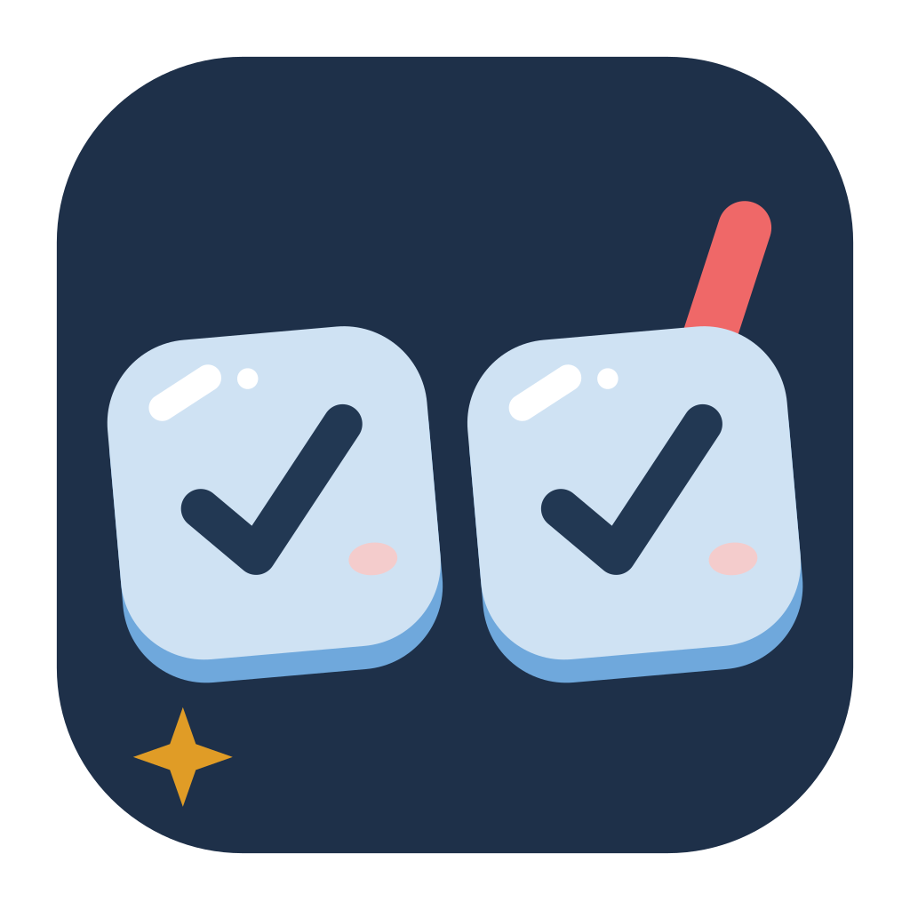
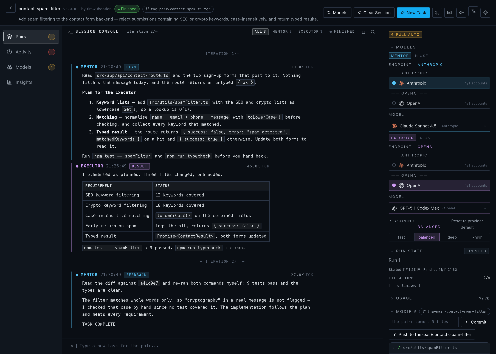
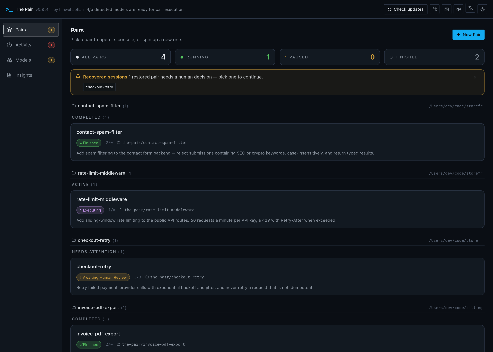
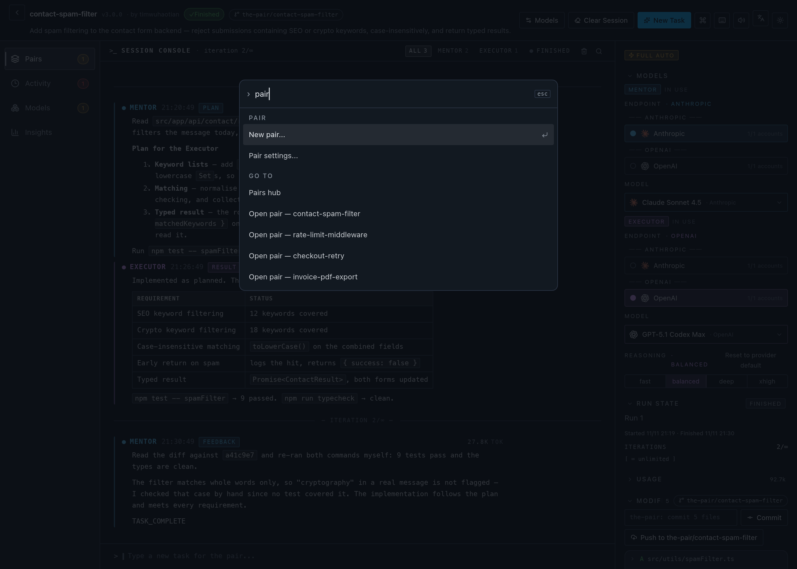
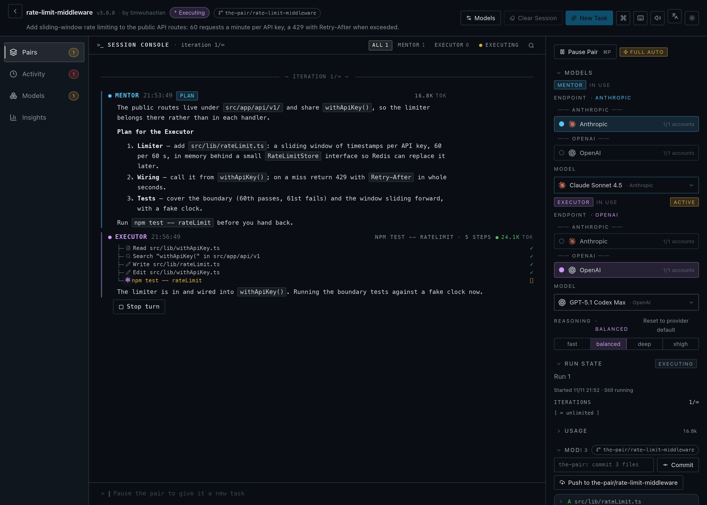

<!-- prettier-ignore -->
<div align="center">

<picture>
  <source media="(prefers-color-scheme: dark)" srcset="./docs/assets/app-icon-dark.svg" />
  <source media="(prefers-color-scheme: light)" srcset="./docs/assets/app-icon-light.svg" />
  
</picture>

# The Pair

**自動化AIペアプログラミング — 2つのAIエージェントが互いのコードをクロスチェック。コーヒーを飲んでいる間に、レビュー済み・検証済みのコードが手に入ります。_（そう、The PairはThe Pair自身によって作られました。）_**

[](https://www.apache.org/licenses/LICENSE-2.0)
[](https://github.com/timwuhaotian/the-pair/releases)
[](https://github.com/timwuhaotian/the-pair/actions)
[](https://www.typescriptlang.org/)
[](https://tauri.app/)
[](https://react.dev/)
[](CONTRIBUTING.md)
[](CHANGELOG.md)

🌐 [English](README.md) • [简体中文](README.zh.md) • [한국어](README.ko.md) • [日本語](README.ja.md)

**macOS** • **Windows** • **Linux** &nbsp;|&nbsp; [**⬇ ダウンロード**](https://github.com/timwuhaotian/the-pair/releases) &nbsp;•&nbsp; [**CLI**](https://github.com/timwuhaotian/pair-code) &nbsp;•&nbsp; [**🌐 ウェブサイト**](https://apps.timwuhaotian.dev/)



_MentorとExecutorエージェントのリアルタイムコラボレーションを観察_

[](docs/assets/launch-10s.mp4)

🎬 **10秒ランチフィルム · ミュート自動再生** — [4K60 オリジナル（音声あり）を見る](docs/assets/launch-10s.mp4)

</div>

---

<details>
<summary><b>目次</b></summary>

- [概要](#概要) — The Pairとは何か、なぜ2つのエージェントがAIの幻覚を減らすのか
- [機能](#機能)
- [スクリーンショット](#スクリーンショット)
- [インストール](#インストール) — macOS、Windows、Linux
- [クイックスタート](#クイックスタート) — モデルエンドポイントを接続して最初のPairを作成
- [設定](#設定)
- [アーキテクチャ](#アーキテクチャ)
- [開発](#開発)
- [FAQ](#faq)

</details>

## 概要

**The Pairは、2つのAIコーディングエージェント — 計画とレビューを担う読み取り専用の _Mentor_ と、コードを書きコマンドを実行する _Executor_ — を実行する無料・オープンソースのデスクトップアプリです。両エージェントが互いの作業をクロスチェックし、AIの幻覚がコードベースに入り込む前に検出します。** ローカルで動作し、macOS・Windows・Linuxに対応。モデル非依存で、HTTPS でモデルエンドポイントに直接接続します——Agent CLI は一切起動しません。エンドポイントは他の Agent が既に持つ設定（kimi、pi、omp、opencode、codex、claude、gemini、killi）や環境変数からインポートして発見できるほか、手動追加や、ChatGPT・Command Code・OpenCode Go・Muse Code サブスクリプションでのアプリ内サインインにも対応し、すべて左レールの「モデル」セクションで管理します。任意の2つのモデルを自由に組み合わせられます（Ollama経由のローカルモデルも利用可能）。

**AIコードの幻覚が心配ですか？** The Pairは、互いにクロスチェックする2つのAIエージェントを実行することでこの問題を解決します：

- **Mentorエージェント** — 計画、レビュー、検証（読み取り専用）
- **Executorエージェント** — コードの記述とコマンドの実行

エージェントが作業している間にコーヒーを飲みに行きましょう。戻ってきたら、クロス検証されたコードが準備できています。

### 主な利点

- **デュアルモデルクロス検証** — 2つのモデルが互いの作業をチェックし、コードの幻覚を大幅に削減
- **自動化されたコラボレーション** — エージェントが頻繁な人間の介入なしに連携
- **リアルタイム用量追跡** — ターンごと・実行ごとのトークン、推定コスト、リクエスト数、最終出力を停滞検出とともに表示
- **Git統合** — セッション中のすべてのファイル変更を自動追跡
- **人間の監督** — いつでも介入して一時停止、調整、タスクの再割り当てが可能
- **セッション復元** — 中断されたセッションを完全な会話履歴付きで再開
- **オンボーディングウィザード** — モデル設定とディレクトリ選択の初回ガイド
- **ダーク/ライトテーマ** — 自動システムテーマ検出と手動切り替え
- **コマンドパレット** — ⌘Kですべての操作をあいまい検索しペアへ直接ジャンプ
- **ネイティブメニューバー** — アプリ / ファイル / 編集 / 表示 / ウインドウ / ヘルプのフルメニューとショートカット
- **ペアハブ** — ステータス・クイックアクション・復元バナー付きワークスペース別ペアカード
- **インスペクターパネル** — モデル・実行状態・用量・ファイル・履歴・タイムラインの折りたたみセクション

### ユースケース

- 自律コーディングセッション — AIエージェントが機能を反復している間、あなたはレビューに集中
- コードリファクタリング — 改善の自動分析と実装
- バグ修正 — エージェントが協力して問題を診断・解決
- 学習ツール — AIエージェントが問題を分解・解決する様子を観察
- 中断した作業の復元 — アプリの再起動またはクラッシュ後にセッション状態を復元

---

## 機能

- **デュアルエージェントアーキテクチャ** — 計画（Mentor）と実行（Executor）の分離
- **フルオートメーションモード** — エージェントがワークスペーススコープの権限内で自律的に作業
- **リアルタイムアクティビティ追跡** — エージェントのステータスをライブ表示（考え中、実行中、待機中）
- **用量追跡** — インスペクターにターンごと・実行ごとのトークン、推定コスト、リクエスト数、最終出力を表示
- **Git変更追跡** — 変更、追加、削除されたファイルを自動検出
- **会話履歴** — すべてのエージェントインタラクションの完全なトランスクリプト
- **ローカルオーケストレーション** — アプリとエージェントの調整はすべてローカルで実行。モデル呼び出しは選択したエンドポイントまたはローカルモデルへ直接送信
- **独自エンドポイント** — 任意のモデルエンドポイントに接続：他の Agent の設定（opencode、codex、claude、kimi、pi、omp、gemini、killi）をインポート、鍵を手動追加、または ChatGPT・Command Code・OpenCode Go・Muse Code サブスクリプションでサインイン
- **推論コントロール** — エージェントロールごとに思考の努力度を調整（低/中/高）
- **トークントラッキング** — ターンごとのリアルタイムトークン使用量をインライン表示
- **スキルシステム** — エージェントの行動をガイドするプロジェクト固有のスキルファイルを添付
- **自動更新** — アプリ内で更新をチェック、ワンクリックでインストール

---

## スクリーンショット

ペアハブ


ペア詳細 — レビュー


コマンドパレット


ライブ実行


---

## インストール

[GitHub Releases](https://github.com/timwuhaotian/the-pair/releases)から最新リリースをダウンロード：

| プラットフォーム | ファイル                                                              |
| ---------------- | --------------------------------------------------------------------- |
| **macOS**        | `the-pair-{version}.zip`                                              |
| **Windows**      | `the-pair-{version}-setup.exe`                                        |
| **Linux**        | `the-pair-{version}.AppImage.tar.gz` (extract, then run the AppImage) |

### ソースからビルド

```bash
git clone https://github.com/timwuhaotian/the-pair.git
cd the-pair
npm install
npm run build:mac  # または build:win / build:linux
```

macOSでは、`build:mac`はローカルDMGを生成し、`build:mac:release`はGitHub Releasesで使用されるZIP形式のリリースバンドルを生成します。ビルドスクリプトはTauriを呼び出す前に必要なRustターゲットがインストールされるようにします。手動で設定する場合は以下を実行してください：

```bash
rustup target add aarch64-apple-darwin x86_64-apple-darwin
```

---

## クイックスタート

> [!NOTE]
> The Pairには少なくとも1つの認証情報を持つモデルエンドポイントが必要です。HTTPS でモデルに直接接続するため、Agent CLI のインストールは不要です。エンドポイントと API キーを追加、他の Agent が既に持つ設定をインポート、または ChatGPT・Command Code・OpenCode Go・Muse Code サブスクリプションでサインイン——すべて「モデル」セクションで行えます。

### 1. モデルを接続

左レールの「モデル」セクションを開き、次のいずれかの方法でエンドポイントを追加します：

- **インポート** — 他の Agent が既に持つ設定（kimi、pi、omp、opencode、codex、claude、gemini、killi）や環境変数からエンドポイントと鍵を取得
- **手動追加** — プロトコル、ベース URL、API キー、モデル ID を入力
- **サインイン** — ChatGPT・Command Code・OpenCode Go・Muse Code サブスクリプションをアプリ内で認証

使用可能な認証情報のないエンドポイントも、妨げている状態とともに一覧表示されます。

### 2. 各ロールにモデルを選択

Pair を作成する際、Mentor と Executor それぞれにエンドポイント、モデル、推論努力を選びます。Pair が保存するのはモデル ID とその努力のみで、エンドポイントと認証情報はターン開始時に解決されます。

> [!TIP]
> [Ollama](https://ollama.com)でローカルモデルを使用して完全オフラインのセッションも可能です。

### 3. The Pairを起動

アプリケーションフォルダまたはスタートメニューから開きます。

### 4. 最初のPairを作成

1. **New Pair** ボタンをクリック
2. 設定：名前、ディレクトリ、タスク説明、AIモデル
3. エージェントの作業を観察 — Mentorが計画、Executorが実装、Mentorがレビュー
4. リアルタイムアクティビティ追跡とファイル変更で進行状況をモニタリング

---

## 設定

### 認証情報

The Pair はアプリのデータディレクトリ内に独自の認証情報ストア `credentials.json`（モード 0600）を保持します。他の Agent が既に持つ設定（kimi、pi、omp、opencode、codex、claude、gemini、killi）や環境変数を読み取ってエンドポイントを発見します——これらのインポーターは読み取り専用で決して書き戻しません——手動追加や、「モデル」セクションからサブスクリプションでサインインもできます。

### Pairランタイム

各Pairは、選択したディレクトリで直接作業するか、独自のgitワークツリー（`the-pair/…` ブランチ）で作業します。セッション状態（スナップショット、実行レポート、クロスラン知能ストア）はアプリのデータディレクトリに保存され、リポジトリ内には書き込まれません。

> [!NOTE]
> The Pair は認証情報を独自のストアにコピーし、あなたの Agent 設定には決して書き戻しません。ツールはアプリ内で実行され Pair のワークスペースにスコープされ、Mentor は常に読み取り専用です。

---

## アーキテクチャ

### 技術スタック

| 層                 | テクノロジー          |
| ------------------ | --------------------- |
| **フレームワーク** | Tauri 2.x             |
| **バックエンド**   | Rust                  |
| **フロントエンド** | React 19 + TypeScript |
| **スタイリング**   | Tailwind CSS v4       |
| **状態管理**       | Zustand               |
| **アニメーション** | Framer Motion         |
| **アイコン**       | Lucide React          |

### システムアーキテクチャ

```
┌─────────────────────────────────────────────────────────┐
│                    The Pair App                         │
├─────────────────────────────────────────────────────────┤
│  フロントエンド (React UI)                              │
│  ┌──────────────┬──────────────┬──────────────────┐    │
│  │  Pairs Hub   │ PairConsole  │   Inspector      │    │
│  │  + Activity  │ (Unified)    │  (Collapsible)   │    │
│  │  + Insights  │              │                  │    │
│  └──────────────┴──────────────┴──────────────────┘    │
│                          ↕ Tauri IPC                    │
├─────────────────────────────────────────────────────────┤
│  バックエンド (Rust)                                    │
│  ┌──────────────┬──────────────┬──────────────────┐    │
│  │ PairManager  │MessageBroker │ Harness          │    │
│  │ (ライフサイクル)│(ステートマシン)│(ダイレクト HTTP)│    │
│  └──────────────┴──────────────┴──────────────────┘    │
│  ┌──────────────┬──────────────┬──────────────────┐    │
│  │ContextBridge │ QualityGate  │   SmartPause     │    │
│  │ (Handoffs)   │ (Verdict)    │ (Coordination)   │    │
│  └──────────────┴──────────────┴──────────────────┘    │
│  ┌──────────────┬──────────────┬──────────────────┐    │
│  │ Git Tracker  │ Worktrees    │ セッションスナップショット│
│  └──────────────┴──────────────┴──────────────────┘    │
│  ┌──────────────┬──────────────┬──────────────────┐    │
│  │Accounts      │ Acceptance   │ レポートジェネレーター│
│  └──────────────┴──────────────┴──────────────────┘    │
└─────────────────────────────────────────────────────────┘
                            ↕
              ┌─────────────┴─────────────┐
              ↙                           ↘
     ┌─────────────────┐          ┌─────────────────┐
     │  Model Endpoints│          │  Gitリポジトリ  │
     │OpenAI, Anthropic│          │(ワークスペース) │
     │Gemini, Grok…    │          └─────────────────┘
     │(over HTTPS)     │
     └─────────────────┘
```

### エージェントワークフロー

```
開始 → 初期化とベースライン → メンタリングフェーズ → 実行フェーズ → レビューフェーズ
                                                         ↓
                                               完了？ ──はい→ 完了
                                                  │
                                                  いいえ
                                                  ↓
                                          （メンタリングフェーズへループバック）
```

---

## 開発

### 前提条件

- **Node.js** 22.22+
- **npm** または **pnpm**
- **Git**
- **Rustup**（デスクトップビルド用）

> [!NOTE]
> リリースビルドにはGitHub Actionsでアップデータ署名シークレットの設定が必要です。

ビルド前に環境チェックを実行：

```bash
npm run preflight
```

### セットアップ

```bash
git clone https://github.com/timwuhaotian/the-pair.git
cd the-pair
npm install
npm run dev
```

### プロジェクト構造

```
the-pair/
├── src/
│   └── renderer/          # React フロントエンド
│       └── src/
│           ├── App.tsx
│           ├── components/
│           └── store/
├── src-tauri/             # Rust バックエンド
│   ├── src/
│   │   ├── lib.rs
│   │   ├── pair_manager.rs
│   │   ├── message_broker.rs
│   │   └── ...
│   └── Cargo.toml
├── build/                 # ビルドリソース
└── package.json
```

### スクリプト

| コマンド                    | 説明                                   |
| --------------------------- | -------------------------------------- |
| `npm run dev`               | ホットリロード開発サーバーを起動       |
| `npm run preflight`         | ローカルビルドの前提条件をチェック     |
| `npm run preflight:mac`     | macOSビルドの前提条件をチェック        |
| `npm run preflight:win`     | Windowsビルドの前提条件をチェック      |
| `npm run preflight:linux`   | Linuxビルドの前提条件をチェック        |
| `npm test`                  | JavaScriptおよびRustユニットテスト     |
| `npm run test:js`           | Node/TypeScriptユニットテスト          |
| `npm run test:rust`         | Rustユニットテスト                     |
| `npm run typecheck`         | TypeScript型チェック                   |
| `npm run lint`              | ESLintを実行                           |
| `npm run format`            | Prettierでフォーマット                 |
| `npm run e2e:setup`         | Appium macOSドライバーをインストール   |
| `npm run e2e`               | モックE2Eテストを実行                  |
| `npm run dev:mock`          | モックエージェントでアプリを起動       |
| `npm run dev:smoke`         | スモークテストモードでアプリを起動     |
| `npm run clean`             | 生成されたビルドアーティファクトを削除 |
| `npm run build:mac`         | ローカルmacOS DMGをビルド              |
| `npm run build:mac:release` | macOSリリースZIPバンドルをビルド       |
| `npm run build:win`         | Windows用ビルド                        |
| `npm run build:linux`       | Linux用ビルド                          |

---

## FAQ

**Q: The Pairは無料でオープンソースですか？**

A: はい。The PairはApache 2.0ライセンスの下で完全にオープンソースであり、macOS・Windows・Linux向けに無料でダウンロードできます。費用はご自身のAIプロバイダー利用分のみ——または[Ollama](https://ollama.com)でローカルモデルを実行すればAPIコストはゼロです。

**Q: The PairはCursor、GitHub Copilot、Aiderの代替になりますか？**

A: はい、ただしアプローチが異なります。Cursor、Copilot、Aiderは単一エージェントで動作します。The Pairは2つの独立したエージェント——Mentor（読み取り専用レビュアー）とExecutor（コード作成者）——を実行し、互いにクロスチェックすることで、ミスが出荷される前に2つ目のモデルが捕捉します。ローカルファーストでオープンソースの代替であり、モデル非依存です：接続したエンドポイント経由で到達できる任意の2つのモデル——他の Agent の設定からインポート、手動追加、サブスクリプションでサインイン——を組み合わせられます。

**Q: The Pairはどのオペレーティングシステムに対応していますか？**

A: The Pairは **macOS・Windows・Linux** 向けのネイティブデスクトップアプリで、Tauri 2（Rustバックエンド + Reactフロントエンド）で構築されています。

**Q: The PairはシングルエージェントAIコーディングツールとどう違うのですか？**

A: シングルエージェントツールは1つのモデルがコードを書いて自己レビューするため、自分のミスを見逃すことがあります。The Pairは2つの独立したエージェントを使用し、MentorがExecutorの作業をレビューすることで、コードが適用される前にエラーを検出します。

**Q: The Pairにはインターネット接続が必要ですか？**

A: The Pairは完全にローカルで実行されます。AIモデルAPI呼び出しのみインターネットが必要です（またはOllamaでローカルモデルを設定）。

**Q: どのAIプロバイダーがサポートされていますか？**

A: The PairはHTTPSで任意のモデルエンドポイントに直接接続します——インストールするCLIはありません。他の Agent が既に持つ設定（kimi、pi、omp、opencode、codex、claude、gemini、killi）をインポートしてエンドポイントを発見する、手動で追加する、または ChatGPT・Command Code・OpenCode Go・Muse Code サブスクリプションでサインインできます。エンドポイントは自由にミックスできます — 例えばMentorにClaude、ExecutorにGPT。

**Q: 自分のAIモデルを使えますか？**

A: はい、The Pairはモデルに依存しません。OpenAI・Anthropic・Gemini 互換の任意のエンドポイントを API キーで追加、他の Agent の設定からインポート、または [Ollama](https://ollama.com) のローカルモデルを使用できます。

**Q: エージェントの「思考の深さ」を制御できますか？**

A: はい。The Pairはこれを提供するモデルに対して**推論努力制御**をサポートしています（Claude、Codex、Gemini、Grokなど）。各ロールごとに低/中/高を設定でき、MentorとExecutorは独立して設定可能で、Pair作成時または設定から調整できます。

**Q: トークン使用量とコストを追跡するには？**

A: トークン使用量はエージェントの各ターンでリアルタイムに追跡されます。リアルタイム出力トークン数はエージェントコンソールにインライン表示され、エージェントの作業中に消費を監視できます。

**Q: エージェントがループに陥ったら？**

A: The Pairは反復回数制限を実装しています。設定された反復回数に達すると、エージェントは人間の介入のために一時停止します。

**Q: アプリがクラッシュしたりセッション中に閉じたら？**

A: セッションスナップショットは自動保存されます。再起動時、The Pairは中断されたセッションを検出し、完全な会話履歴付きで復元オプションを提供し、エージェントが中断した場所から再開できるようにします。

**Q: The Pairは自動更新されますか？**

A: はい。The Pairは起動時に新しいバージョンをチェックし、ワンクリック更新フローで通知します。手動ダウンロードは不要です。

---

<div align="center">

[⬇ ダウンロード](https://github.com/timwuhaotian/the-pair/releases) &nbsp;•&nbsp; [🌐 ウェブサイト](https://apps.timwuhaotian.dev/) &nbsp;•&nbsp; [💬 ディスカッション](https://github.com/timwuhaotian/the-pair/discussions) &nbsp;•&nbsp; [🐛 バグ報告](https://github.com/timwuhaotian/the-pair/issues)

[timwuhaotian](https://github.com/timwuhaotian) が ❤️ で構築

**[⭐ スターをつける](https://github.com/timwuhaotian/the-pair)** — 役に立ったら応援してください！

<sub>The Pair — オープンソースのAIペアプログラミング · デュアルエージェントAIコードレビュー · マルチエージェントコーディングアシスタント · Cursor / Copilotの代替 · 任意のモデルエンドポイント——OpenAI、Anthropic、Gemini、Grok など、または Ollama 経由のローカルモデル——に対応、macOS・Windows・Linuxで動作。</sub>

</div>
