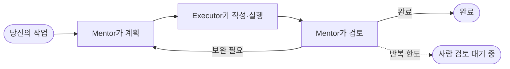

<!-- prettier-ignore -->
<div align="center">


# The Pair

**하나의 작업에 두 개의 AI 에이전트. 하나는 코드를 쓰고, 다른 하나는 검토합니다.**

데스크톱에서 실행되는 오픈소스 AI 페어 프로그래밍. 읽기 전용 **Mentor**가 계획과 검토를 맡고,
**Executor**가 코드를 작성하고 명령을 실행하며, 서로의 작업을 확인한 뒤에야
코드베이스에 반영합니다. _(네, The Pair는 The Pair로 만들었습니다.)_

[](https://github.com/timwuhaotian/the-pair/releases)
[](https://github.com/timwuhaotian/the-pair/releases)
[](https://github.com/timwuhaotian/the-pair/actions)
[](LICENSE)
[](https://github.com/timwuhaotian/the-pair/stargazers)

[English](README.md) · [简体中文](README.zh.md) · [日本語](README.ja.md) · **한국어**

[**⬇ 다운로드**](https://github.com/timwuhaotian/the-pair/releases) &nbsp;·&nbsp; [**빠른 시작**](#빠른-시작) &nbsp;·&nbsp; [**CLI**](https://github.com/timwuhaotian/pair-code) &nbsp;·&nbsp; [**웹사이트**](https://apps.timwuhaotian.dev/)

<sub>macOS · Windows · Linux</sub>

<br />


<sub>완료된 실행: Mentor가 계획하고, Executor가 구현하고, Mentor가 diff를 읽고 승인했습니다.</sub>

</div>

<br />

## 왜 에이전트가 둘인가

코드를 작성한 모델에게 자기 코드를 검토하게 하면 대개 스스로에게 동의합니다. The Pair는 이 일을 둘로 나누어 서로 다른 에이전트에게 — 원한다면 서로 다른 모델에게 — 맡깁니다.

| 역할         | 하는 일                                                 | 손댈 수 있는 범위       |
| ------------ | ------------------------------------------------------- | ----------------------- |
| **Mentor**   | 코드를 읽고, 계획을 쓰고, 모든 결과를 검토합니다        | 읽기 전용               |
| **Executor** | 코드를 쓰고, 명령을 실행하고, 검증한 뒤 결과를 넘깁니다 | 해당 Pair의 작업 공간뿐 |



실행은 Mentor가 완료를 알리거나 당신이 멈출 때까지 계속됩니다. Pair에 반복 한도를 설정해 두면 한도에 도달했을 때 일시 중지되어 검토를 기다리므로, 계속하거나 모델을 바꾸거나 끝낼 수 있습니다. 일하는 동안 커피 한 잔 하러 다녀오세요 — 물론 자리를 지키며 방향을 잡아도 됩니다. 턴을 멈추고, 피드백을 보내고, 코드가 한 줄도 쓰이기 전에 계획을 승인할 수 있습니다.

### 비교

| 기능                  | The Pair                | Cursor / Copilot | Claude Code(단독) |
| --------------------- | ----------------------- | ---------------- | ----------------- |
| 에이전트 간 교차 검증 | ✅ 독립된 두 에이전트   | ❌ 단일 에이전트 | ❌ 단일 에이전트  |
| 전담 검토 역할        | ✅ Mentor(읽기 전용)    | ❌ 자기 검토뿐   | ❌ 자기 검토뿐    |
| 멀티 프로바이더       | ✅ 모든 모델 엔드포인트 | ❌ 한 곳에 고정  | ❌ Claude 전용    |
| 로컬 오케스트레이션   | ✅ 완전 로컬            | ❌ 클라우드 의존 | ❌ 클라우드 의존  |
| 세션 복구             | ✅ 스냅샷으로 전체 복원 | ❌               | ❌                |
| 오픈소스              | ✅ Apache 2.0           | ❌ 독점          | ❌ 독점           |

## 둘러보기

<table>
  <tr>
    <td width="50%" valign="top">
      
      <br />
      <b>턴이 진행되는 모습을 실시간으로</b><br />
      <sub>Executor의 모든 읽기, 편집, 명령이 실시간으로 보이고, 중지 버튼도 바로 옆에 있습니다.</sub>
    </td>
    <td width="50%" valign="top">
      
      <br />
      <b>모든 Pair를 한 허브에서</b><br />
      <sub>상태, 반복, 브랜치를 한눈에 보고, 중단된 세션은 복구를 제안받습니다.</sub>
    </td>
  </tr>
  <tr>
    <td width="50%" valign="top">
      
      <br />
      <b>내 모델을 그대로</b><br />
      <sub>엔드포인트, 계정, 자격 증명을 한곳에서 관리합니다. 에이전트 CLI를 설치할 필요가 없습니다.</sub>
    </td>
    <td width="50%" valign="top">
      
      <br />
      <b>⌘K 하나로 전부</b><br />
      <sub>모든 동작을 퍼지 검색하는 팔레트. 어느 Pair로든 바로 이동합니다.</sub>
    </td>
  </tr>
</table>

## 기능

**루프**

- **듀얼 에이전트 아키텍처** — 계획과 검토(Mentor)를 실행(Executor)과 분리
- **스마트 조율** — 구조화된 핸드오프 프롬프트, 품질 게이트, 스마트 일시 중지로 반복이 흐트러지지 않게
- **수락 검사** — Mentor가 테스트와 lint를 실행한 뒤 위험도, 근거, 다음 단계를 담은 판정을 반환
- **계획 게이트와 반복 한도** — 첫 계획을 직접 승인하도록 할 수 있고, Pair별 반복 한도도 설정 가능(기본은 무제한)
- **정체 감지** — 출력이 120초 없으면 경고, 600초면 정체로 표시

**콘솔**

- **하나의 세션 콘솔** — 작업, 계획, 결과, 검토, 실시간 턴을 하나의 스크롤 피드에. 검색과 역할 필터 포함
- **인지 이벤트 스트림** — 턴마다 인텐트 칩, 추론 단계, 도구 호출 상태
- **사용량 추적** — 턴별·실행별 토큰, 예상 비용, 요청 수, 마지막 출력
- **인스펙터** — 모델, 실행 상태, 사용량, 파일, 기록, 타임라인을 접을 수 있는 섹션으로
- **활동과 인사이트** — 모든 Pair 중 주의가 필요한 것, 그리고 잘 통했던 모델 조합

**당신의 저장소**

- **Git 변경 추적** — 기준 커밋 대비 추가·수정·삭제된 파일을 파일별 인라인 diff와 함께
- **워크트리** — 작업마다 전용 git worktree와 `the-pair/…` 브랜치에서 실행하고, 인스펙터에서 바로 커밋과 푸시
- **스킬과 멘션** — `/skill`로 프로젝트 스킬 파일을, `@path`로 파일을 첨부
- **세션 복구** — 진행하면서 스냅샷을 저장하고, 중단된 세션은 기록과 턴 상태까지 되돌립니다

**모델**

- **엔드포인트는 직접 가져오기** — 다른 에이전트의 설정(opencode, codex, claude, kimi, pi, omp, gemini, killi)을 가져오거나, 키를 직접 추가하거나, ChatGPT·Command Code·OpenCode Go·Muse Code 구독으로 로그인
- **어떤 모델이든 어느 역할에나** — Mentor와 Executor 각각의 엔드포인트, 모델, 추론 강도를 따로 선택
- **로컬 오케스트레이션** — 앱과 조율 로직은 내 컴퓨터에서 실행되고, 모델 호출은 선택한 엔드포인트나 로컬 모델로 직접 전송

**앱**

- **명령 팔레트와 단축키** — 모든 동작에 닿는 ⌘K, 전역 단축키, 네이티브 메뉴 바
- **네 가지 언어** — English, 简体中文, 日本語, 한국어
- **라이트/다크 테마**, 한 번에 음소거할 수 있는 사운드 알림, 앱 내 업데이트

## 설치

[GitHub Releases](https://github.com/timwuhaotian/the-pair/releases)에서 최신 버전을 다운로드하세요:

| 플랫폼      | 파일                                                             |
| ----------- | ---------------------------------------------------------------- |
| **macOS**   | `the-pair-{version}.zip`                                         |
| **Windows** | `the-pair-{version}-setup.exe`                                   |
| **Linux**   | `the-pair-{version}.AppImage.tar.gz` (압축을 풀고 AppImage 실행) |

터미널이 더 편하신가요? **CLI** 사용자는 The Pair의 터미널 에디션인 [Pair Code](https://github.com/timwuhaotian/pair-code)를 [npm](https://www.npmjs.com/package/pair-code)에서 설치할 수 있습니다:

```bash
npm install -g pair-code
```

| 인터페이스   | 이런 경우에                                    | 시작하기                                                               |
| ------------ | ---------------------------------------------- | ---------------------------------------------------------------------- |
| **데스크톱** | 시각적 모니터링, 설치 프로그램, 오래 도는 Pair | [The Pair 다운로드](https://github.com/timwuhaotian/the-pair/releases) |
| **CLI**      | 터미널 중심 작업, 스크립트, SSH 세션           | [Pair Code](https://github.com/timwuhaotian/pair-code)                 |

<details>
<summary><b>소스에서 빌드</b></summary>

<br />

```bash
git clone https://github.com/timwuhaotian/the-pair.git
cd the-pair
npm install
npm run build:mac  # 또는 build:win / build:linux
```

macOS에서 `build:mac`은 로컬용 DMG를, `build:mac:release`는 GitHub Releases에 쓰이는 ZIP 번들을 만듭니다. 빌드 스크립트는 Tauri를 호출하기 전에 필요한 Rust 타깃을 설치합니다. 직접 설정하려면:

```bash
rustup target add aarch64-apple-darwin x86_64-apple-darwin
```

</details>

## 빠른 시작

> [!NOTE]
> The Pair에는 자격 증명이 있는 모델 엔드포인트가 하나 필요합니다. 모델과는 HTTPS로 직접 통신하며, 설치할 에이전트 CLI는 없습니다.

**1. 모델을 연결합니다.** 왼쪽 레일의 **모델**을 열고 다음 중 하나의 방법으로 엔드포인트를 추가하세요:

- **agent 스캔** — 다른 에이전트가 이미 가진 엔드포인트와 키(kimi, pi, omp, opencode, codex, claude, gemini, killi) 또는 환경 변수의 것을 가져오기
- **엔드포인트 추가** — 프로토콜, 베이스 URL, API 키, 모델 ID 입력
- **로그인** — ChatGPT, Command Code, OpenCode Go, Muse Code 구독을 앱 안에서 인증

쓸 수 있는 자격 증명이 없는 엔드포인트도, 무엇이 막고 있는지와 함께 목록에 표시됩니다.

**2. Pair를 만듭니다.** **새 페어**를 클릭하고, 디렉터리를 고르고, 작업을 설명한 뒤, Mentor와 Executor 각각의 엔드포인트, 모델, 추론 강도를 선택하세요.

**3. 지켜보세요. 아니면 말고요.** Mentor가 계획하고, Executor가 구현하고, Mentor가 검토합니다. 콘솔에서 따라가다가 원할 때 개입하고, 끝나면 변경된 파일을 확인하세요.

> [!TIP]
> 완전히 오프라인으로 쓰려면 [Ollama](https://ollama.com)를 통한 로컬 모델을 사용하세요.

## 설정

**자격 증명**은 앱 데이터 디렉터리에 있는 앱 자체 저장소 `credentials.json`(모드 0600)에 보관됩니다. 다른 에이전트의 설정과 환경 변수를 읽는 임포터는 읽기만 하며, 다시 쓰지 않습니다.

**Pair 런타임.** 각 Pair는 선택한 디렉터리에서 직접 작업하거나, 전용 git worktree와 `the-pair/…` 브랜치에서 작업합니다. 세션 상태 — 스냅샷, 실행 보고서, 실행 간 인텔리전스 저장소 — 는 앱 데이터 디렉터리에 남고, 저장소 안에는 절대 쓰이지 않습니다.

> [!NOTE]
> 에이전트의 도구는 앱 안에서 실행되고 해당 Pair의 작업 공간으로 범위가 제한되며, Mentor는 항상 읽기 전용입니다.

## 아키텍처

Tauri 2 앱입니다. Rust 백엔드가 HTTPS로 모델 엔드포인트와 통신하며 에이전트의 도구를 실행하고, React 프런트엔드가 대화와 컨트롤을 렌더링합니다.

| 레이어         | 들어 있는 것                                                                                                  |
| -------------- | ------------------------------------------------------------------------------------------------------------- |
| **프런트엔드** | React 19 + TypeScript, Tailwind CSS v4, Zustand, Framer Motion — Pairs 허브, 세션 콘솔, 인스펙터              |
| **브리지**     | Tauri IPC                                                                                                     |
| **백엔드**     | Rust — Pair 라이프사이클, 턴 상태 머신, 응답을 스트리밍하고 도구를 실행하는 하네스                            |
| **모델**       | 와이어 프로토콜별 스트리밍 클라이언트(OpenAI Chat, Anthropic, Responses, Command Code)와 자격 증명 레지스트리 |
| **Git**        | 기준 커밋 대비 변경 추적, 워크트리, 세션 스냅샷                                                               |

```
Idle → Mentoring → Executing → Reviewing → (loop | Finished | Paused | Awaiting Human Review | Error)
```

전체 모듈 구성은 `AGENTS.md`에 있습니다.

## 개발

**Node.js 22.22+**, **Git**, 그리고 데스크톱 빌드에는 **Rustup**이 필요합니다.

```bash
git clone https://github.com/timwuhaotian/the-pair.git
cd the-pair
npm install
npm run preflight   # 툴체인 확인
npm run dev         # 핫 리로드로 앱 실행
npm run dev:mock    # 같은 방식이지만 준비된 턴을 쓰고 모델은 호출하지 않음
```

<details>
<summary><b>모든 스크립트</b></summary>

<br />

| 명령어                      | 설명                                   |
| --------------------------- | -------------------------------------- |
| `npm run dev`               | 핫 리로드로 앱 실행                    |
| `npm run dev:mock`          | 모의 에이전트로 앱 실행                |
| `npm run dev:smoke`         | 스모크 테스트 모드로 앱 실행           |
| `npm run preflight`         | 로컬 빌드 사전 요구 사항 확인          |
| `npm test`                  | JavaScript·컴포넌트·Rust 테스트 실행   |
| `npm run test:js`           | Node/TypeScript 단위 테스트 실행       |
| `npm run test:ui`           | 컴포넌트 테스트 실행                   |
| `npm run test:rust`         | Rust 테스트 실행                       |
| `npm run typecheck`         | TypeScript 타입 검사                   |
| `npm run lint`              | ESLint 실행                            |
| `npm run format`            | Prettier로 포맷                        |
| `npm run e2e:web`           | 모의 IPC 대상 헤드리스 E2E 테스트 실행 |
| `npm run e2e:setup`         | Appium macOS 드라이버 설치             |
| `npm run e2e`               | macOS에서 모의 E2E 테스트 실행         |
| `npm run clean`             | 생성된 빌드 산출물 삭제                |
| `npm run build:mac`         | 로컬용 macOS DMG 빌드                  |
| `npm run build:mac:release` | macOS 릴리스용 ZIP 번들 빌드           |
| `npm run build:win`         | Windows용 빌드                         |
| `npm run build:linux`       | Linux용 빌드                           |

</details>

이 페이지의 스크린샷은 앱 자체에서 생성합니다: `node scripts/readme-shots.mjs` (미리 실행해 둘 것은 파일 첫머리에 적혀 있습니다).

기여를 환영합니다 — [CONTRIBUTING.md](CONTRIBUTING.md)와 [변경 기록](CHANGELOG.md)을 참고하세요.

## FAQ

<details>
<summary><b>The Pair는 무료이고 오픈소스인가요?</b></summary>

네. The Pair는 Apache 2.0 라이선스의 오픈소스이며 macOS, Windows, Linux용으로 무료로 다운로드할 수 있습니다. 비용은 본인의 모델 사용량뿐이고, [Ollama](https://ollama.com)로 로컬 모델을 돌리면 API 비용도 없습니다.

</details>

<details>
<summary><b>Cursor, GitHub Copilot, Aider의 대안인가요?</b></summary>

네, 다만 접근 방식이 다릅니다. 그 도구들은 단일 에이전트를 구동합니다. The Pair는 독립된 두 에이전트 — 읽기 전용 Mentor와 Executor — 가 서로를 교차 검증하므로, 실수는 출시되기 전에 두 번째 모델이 잡아냅니다. 로컬 우선이고, 오픈소스이며, 모델에 구애받지 않습니다.

</details>

<details>
<summary><b>어떤 모델을 쓸 수 있나요?</b></summary>

연결한 엔드포인트로 닿을 수 있는 모델이면 무엇이든 — 다른 에이전트의 설정에서 가져왔든, 직접 추가했든, 구독으로 로그인했든 — GPT, Claude, Gemini, Grok, GLM, Qwen, Kimi, MiniMax, DeepSeek, 그리고 Ollama를 통한 로컬 모델까지 됩니다. Claude를 Mentor로, GPT를 Executor로 쓰는 식으로 자유롭게 섞으세요.

</details>

<details>
<summary><b>인터넷 연결이 필요한가요?</b></summary>

앱은 로컬에서 실행됩니다. 연결이 필요한 것은 모델 호출뿐이고, Ollama를 쓰면 그것마저 필요 없습니다.

</details>

<details>
<summary><b>에이전트가 얼마나 "생각"할지 조절할 수 있나요?</b></summary>

네. 지원하는 모델이라면 Pair를 만들 때나 나중에 설정에서 Mentor와 Executor의 추론 강도를 따로 정할 수 있습니다.

</details>

<details>
<summary><b>에이전트가 실제로 무엇을 하는지 볼 수 있나요?</b></summary>

네. 각 턴에는 인지 이벤트 스트림 — 인텐트 칩, 추론 단계, 각 도구 호출과 그 상태 — 이 표시되므로, 원시 출력을 읽지 않고도 에이전트의 논리를 따라갈 수 있습니다.

</details>

<details>
<summary><b>토큰과 비용은 어떻게 추적하나요?</b></summary>

사용량은 턴 단위로, 입력과 출력을 나누어 기록됩니다. 실시간 수치는 콘솔, 인스펙터, 내보낸 실행 보고서에 나타납니다.

</details>

<details>
<summary><b>에이전트가 루프에 빠지면요?</b></summary>

실행은 기본적으로 무제한입니다. 반복 한도를 설정해 두면 한도에 도달했을 때 **사람 검토 대기 중** 상태로 일시 중지되어, 계속하거나 모델을 바꾸거나 끝낼 수 있습니다. 턴 내 스텝 사이클 가드도 폭주하는 도구 루프를 멈춥니다.

</details>

<details>
<summary><b>앱이 죽거나 세션 중에 닫아 버리면요?</b></summary>

세션 스냅샷은 자동으로 저장됩니다. 다음 실행 때 The Pair가 중단된 세션을 찾아 전체 기록과 함께 복원할지 묻습니다.

</details>

<details>
<summary><b>자동으로 업데이트되나요?</b></summary>

네. The Pair는 실행할 때 새 버전을 확인하고, 클릭 한 번으로 설치합니다.

</details>

<br />

---

<div align="center">

[⬇ 다운로드](https://github.com/timwuhaotian/the-pair/releases) &nbsp;·&nbsp; [웹사이트](https://apps.timwuhaotian.dev/) &nbsp;·&nbsp; [토론](https://github.com/timwuhaotian/the-pair/discussions) &nbsp;·&nbsp; [버그 신고](https://github.com/timwuhaotian/the-pair/issues)

[timwuhaotian](https://github.com/timwuhaotian)이 만듭니다. The Pair가 도움이 되었다면 [스타](https://github.com/timwuhaotian/the-pair) 하나가 다른 사람들이 찾는 데 힘이 됩니다.

<sub>The Pair — 오픈소스 AI 페어 프로그래밍 · 듀얼 에이전트 AI 코드 리뷰 · 멀티 에이전트 코딩 어시스턴트 · Cursor와 Copilot의 대안 · 모든 모델 엔드포인트 또는 Ollama를 통한 로컬 모델 지원 · macOS, Windows, Linux.</sub>

</div>
