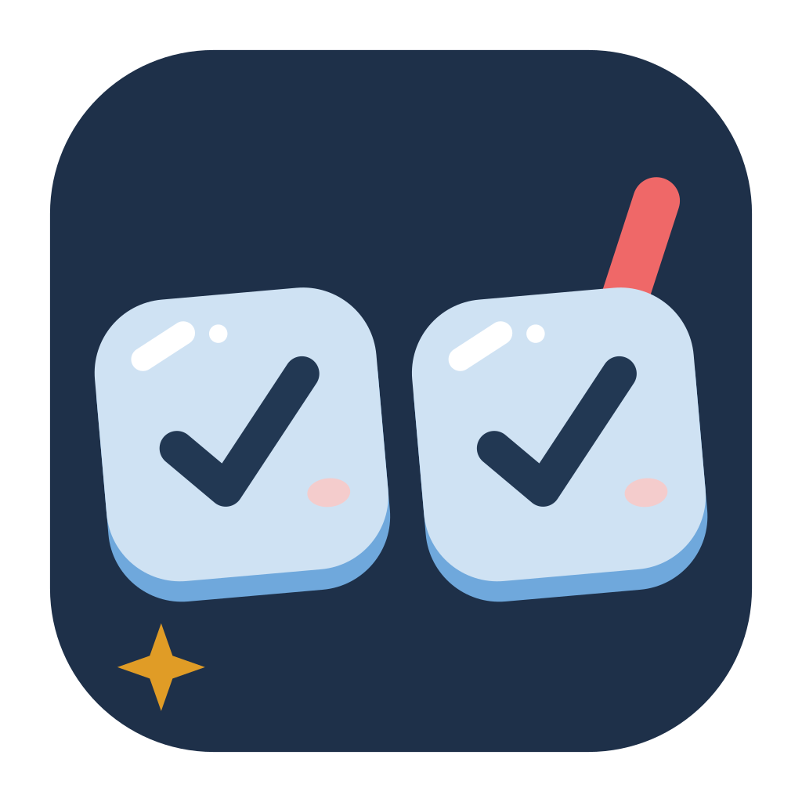
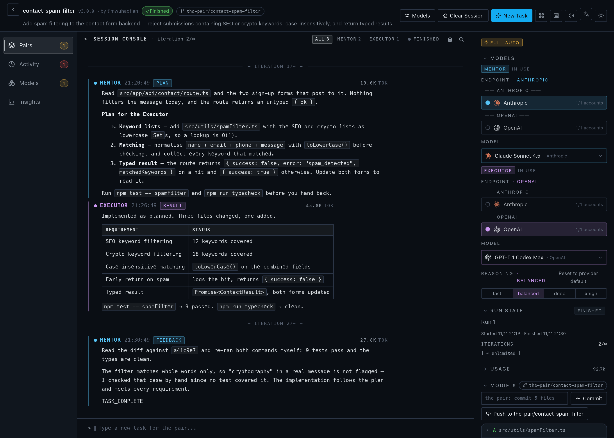
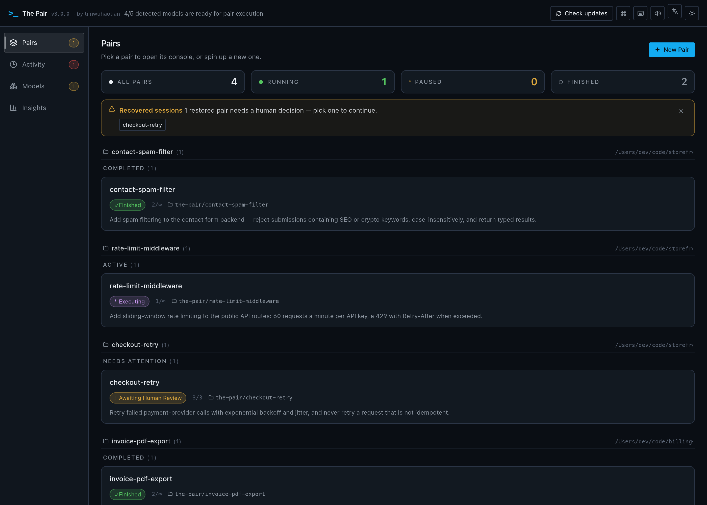
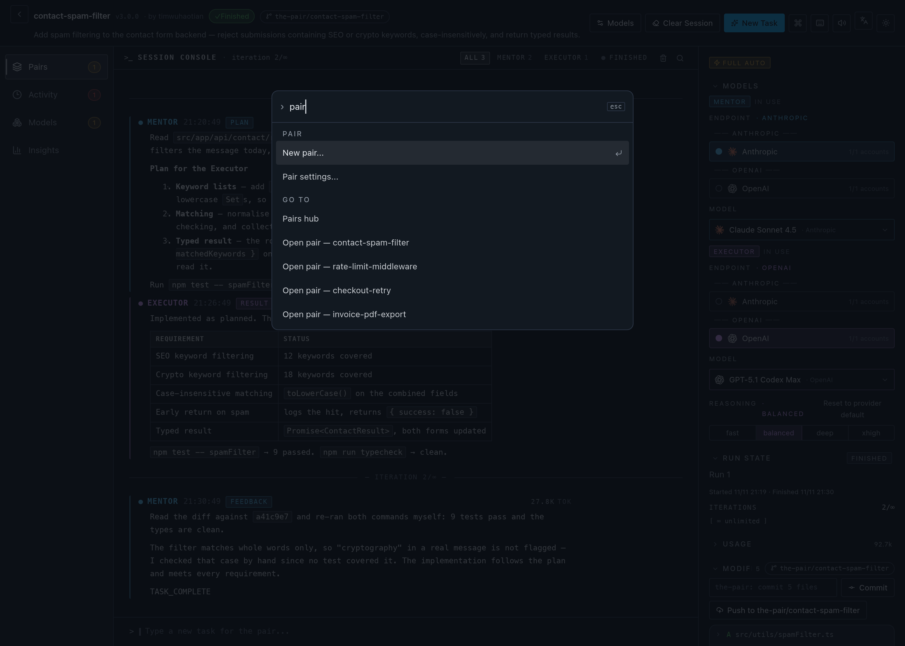
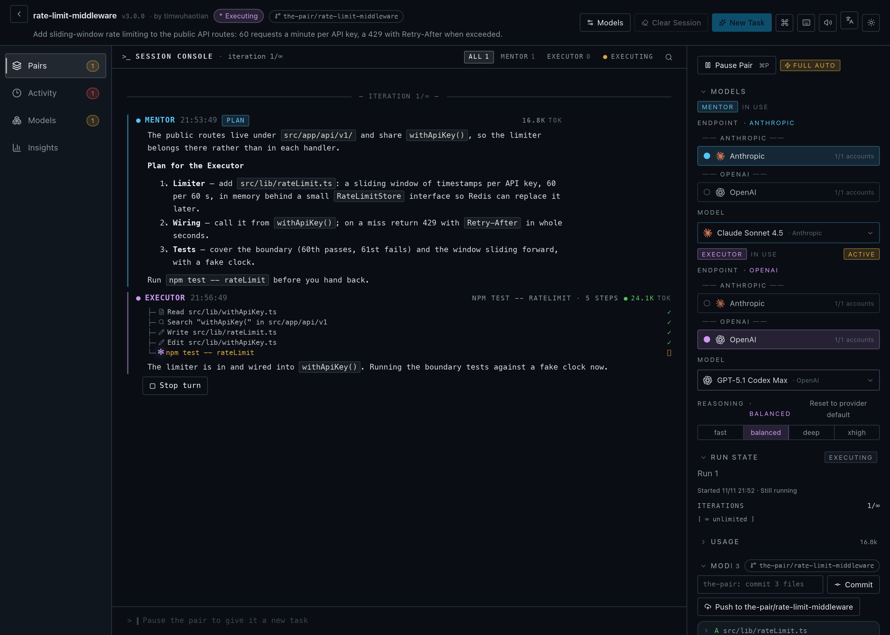

<!-- prettier-ignore -->
<div align="center">

<picture>
  <source media="(prefers-color-scheme: dark)" srcset="./docs/assets/app-icon-dark.svg" />
  <source media="(prefers-color-scheme: light)" srcset="./docs/assets/app-icon-light.svg" />
  
</picture>

# The Pair

**자동화된 AI 페어 프로그래밍 — 두 AI 에이전트가 서로의 코드를 교차 검증합니다. 커피 한 잔 하는 사이에 검토·검증을 마친 코드를 받아보세요. _(맞습니다, The Pair는 The Pair가 직접 만들었습니다.)_**

[](https://www.apache.org/licenses/LICENSE-2.0)
[](https://github.com/timwuhaotian/the-pair/releases)
[](https://github.com/timwuhaotian/the-pair/actions)
[](https://www.typescriptlang.org/)
[](https://tauri.app/)
[](https://react.dev/)
[](CONTRIBUTING.md)
[](CHANGELOG.md)

🌐 [English](README.md) • [简体中文](README.zh.md) • [한국어](README.ko.md) • [日本語](README.ja.md)

**macOS** • **Windows** • **Linux** &nbsp;|&nbsp; [**⬇ 다운로드**](https://github.com/timwuhaotian/the-pair/releases) &nbsp;•&nbsp; [**CLI**](https://github.com/timwuhaotian/pair-code) &nbsp;•&nbsp; [**🌐 웹사이트**](https://apps.timwuhaotian.dev/)



_Mentor와 Executor 에이전트의 실시간 협업 과정을 지켜보세요_

[](docs/assets/launch-10s.mp4)

🎬 **10초 런치 필름 · 음소거 자동 재생** — [4K60 원본(소리 포함) 보기](docs/assets/launch-10s.mp4)

</div>

---

<details>
<summary><b>목차</b></summary>

- [개요](#개요) — The Pair란 무엇이며 두 에이전트가 AI 환각을 줄이는 이유
- [기능](#기능)
- [스크린샷](#스크린샷)
- [설치](#설치) — macOS, Windows, Linux
- [빠른 시작](#빠른-시작) — 모델 엔드포인트를 연결하고 첫 Pair 만들기
- [구성](#구성)
- [아키텍처](#아키텍처)
- [개발](#개발)
- [FAQ](#faq)

</details>

## 개요

**The Pair는 두 개의 AI 코딩 에이전트 — 계획과 검토를 담당하는 읽기 전용 _Mentor_ 와 코드를 작성하고 명령을 실행하는 _Executor_ — 를 실행하는 무료 오픈소스 데스크톱 앱으로, 두 에이전트가 서로의 작업을 교차 검증하여 AI 환각이 코드베이스에 도달하기 전에 잡아냅니다.** 로컬에서 실행되며 macOS, Windows, Linux를 지원하고 모델에 구애받지 않습니다: HTTPS로 모델 엔드포인트에 직접 연결하며 Agent CLI는 전혀 실행하지 않습니다. 엔드포인트는 다른 에이전트가 이미 가진 설정(kimi, pi, omp, opencode, codex, claude, gemini, killi)이나 환경 변수에서 가져와 발견하거나, 수동으로 추가하거나, ChatGPT·Command Code·OpenCode Go·Muse Code 구독으로 앱 내에서 로그인할 수 있으며, 모두 왼쪽 레일의 「모델」 섹션에서 관리합니다. 임의의 두 모델을 자유롭게 조합할 수 있습니다(Ollama를 통한 로컬 모델도 가능).

**AI 코드 환각이 걱정되시나요?** The Pair는 서로를 교차 검증하는 두 AI 에이전트를 실행하여 이 문제를 해결합니다:

- **Mentor 에이전트** — 계획, 검토 및 검증 (읽기 전용)
- **Executor 에이전트** — 코드 작성 및 명령 실행

에이전트가 작업하는 동안 커피 한 잔 하세요. 돌아오면 교차 검증된 코드가 준비되어 있습니다.

### 핵심 장점

- **듀얼 모델 교차 검증** — 두 모델이 서로의 작업을 확인하여 코드 환각을 대폭 감소
- **자동화된 협업** — 에이전트가 빈번한 인간 개입 없이 협업
- **실시간 사용량 추적** — 턴별·실행별 토큰, 예상 비용, 요청 수, 마지막 출력을 정체 감지와 함께 표시
- **Git 통합** — 세션 중 모든 파일 변경 사항 자동 추적
- **인간 감독** — 언제든지 개입하여 일시정지, 조정 또는 작업 재할당 가능
- **세션 복구** — 중단된 세션을 전체 대화 기록과 함께 복원
- **온보딩 마법사** — 모델 구성 및 디렉토리 선택을 위한 첫 실행 가이드
- **다크/라이트 테마** — 자동 시스템 테마 감지 및 수동 전환 지원
- **명령 팔레트** — ⌘K로 모든 동작을 퍼지 검색하고 페어로 바로 이동
- **네이티브 메뉴 바** — 앱 / 파일 / 편집 / 보기 / 창 / 도움말 전체 메뉴와 단축키
- **페어 허브** — 상태·빠른 동작·복구 배너가 있는 워크스페이스별 페어 카드
- **인스펙터 패널** — 모델·실행 상태·사용량·파일·기록·타임라인 접이식 섹션

### 사용 사례

- 자율 코딩 세션 — AI 에이전트가 기능을 반복하는 동안 당신은 검토에 집중
- 코드 리팩토링 — 개선 사항 자동 분석 및 구현
- 버그 수정 — 에이전트가 협업하여 문제 진단 및 해결
- 학습 도구 — AI 에이전트가 문제를 분해하고 해결하는 과정 관찰
- 중단 작업 복구 — 앱 재시작 또는 충돌 후 세션 상태 복원

---

## 기능

- **듀얼 에이전트 아키텍처** — 계획(Mentor)과 실행(Executor) 분리
- **전체 자동화 모드** — 에이전트가 작업 공간 범위 권한 내에서 자율 작업
- **실시간 활동 추적** — 에이전트 활동 상태 실시간 표시 (사고 중, 실행 중, 대기 중)
- **사용량 추적** — 인스펙터에 턴별·실행별 토큰, 예상 비용, 요청 수, 마지막 출력을 표시
- **Git 변경 추적** — 수정, 추가 또는 삭제된 파일 자동 감지
- **대화 기록** — 모든 에이전트 상호작용의 전체 기록
- **로컬 오케스트레이션** — 앱과 에이전트 조정은 모두 로컬에서 실행; 모델 호출은 선택한 엔드포인트 또는 로컬 모델로 직접 전송
- **자체 엔드포인트** — 임의의 모델 엔드포인트 연결: 다른 에이전트의 설정(opencode, codex, claude, kimi, pi, omp, gemini, killi) 가져오기, 키 수동 추가, 또는 ChatGPT·Command Code·OpenCode Go·Muse Code 구독으로 로그인
- **추론 제어** — 에이전트 역할별 사고 노력 조정 (낮음/중간/높음)
- **토큰 추적** — 각 턴당 실시간 토큰 사용량 인라인 표시
- **스킬 시스템** — 에이전트 행동을 가이드하는 프로젝트별 스킬 파일 첨부
- **자동 업데이트** — 앱 내 업데이트 확인 및 원클릭 설치

---

## 스크린샷

페어 허브


페어 상세 — 리뷰


명령 팔레트


실시간 실행


---

## 설치

[GitHub Releases](https://github.com/timwuhaotian/the-pair/releases)에서 최신 릴리스를 다운로드하세요:

| 플랫폼      | 파일                                                                  |
| ----------- | --------------------------------------------------------------------- |
| **macOS**   | `the-pair-{version}.zip`                                              |
| **Windows** | `the-pair-{version}-setup.exe`                                        |
| **Linux**   | `the-pair-{version}.AppImage.tar.gz` (extract, then run the AppImage) |

### 소스에서 빌드

```bash
git clone https://github.com/timwuhaotian/the-pair.git
cd the-pair
npm install
npm run build:mac  # 또는 build:win / build:linux
```

macOS에서 `build:mac`은 로컬 DMG를 생성하고, `build:mac:release`는 GitHub Releases에 사용되는 ZIP 스타일 릴리스 번들을 생성합니다. 빌드 스크립트는 Tauri를 호출하기 전에 필요한 Rust 타겟이 설치되도록 합니다. 수동으로 설정하려면 다음을 실행하세요:

```bash
rustup target add aarch64-apple-darwin x86_64-apple-darwin
```

---

## 빠른 시작

> [!NOTE]
> The Pair에는 최소 하나의 자격 증명을 가진 모델 엔드포인트가 필요합니다. HTTPS로 모델에 직접 연결하므로 설치할 Agent CLI가 없습니다. 엔드포인트와 API 키를 추가하거나, 다른 에이전트가 이미 가진 설정을 가져오거나, ChatGPT·Command Code·OpenCode Go·Muse Code 구독으로 로그인할 수 있습니다 — 모두 「모델」 섹션에서.

### 1. 모델 연결

왼쪽 레일의 「모델」 섹션을 열고 다음 방법 중 하나로 엔드포인트를 추가하세요:

- **가져오기** — 다른 에이전트가 이미 가진 설정(kimi, pi, omp, opencode, codex, claude, gemini, killi)이나 환경 변수에서 엔드포인트와 키를 가져옴
- **수동 추가** — 프로토콜, base URL, API 키, 모델 id 입력
- **로그인** — ChatGPT·Command Code·OpenCode Go·Muse Code 구독을 앱 내에서 인증

사용 가능한 자격 증명이 없는 엔드포인트도 차단 상태와 함께 표시됩니다.

### 2. 각 역할에 모델 선택

Pair를 만들 때 Mentor와 Executor 각각에 대해 엔드포인트, 모델, 추론 노력을 선택하세요. Pair는 모델 id와 그 노력만 저장하며, 엔드포인트와 자격 증명은 턴이 시작될 때 resolve됩니다.

> [!TIP]
> [Ollama](https://ollama.com)와 로컬 모델을 사용하여 완전 오프라인 세션도 가능합니다.

### 3. The Pair 실행

응용 프로그램 폴더 또는 시작 메뉴에서 실행하세요.

### 4. 첫 Pair 만들기

1. **New Pair** 버튼 클릭
2. 구성: 이름, 디렉토리, 작업 설명 및 AI 모델
3. 에이전트 작업 관찰 — Mentor 계획, Executor 구현, Mentor 검토
4. 실시간 활동 추적 및 파일 변경으로 진행 상황 모니터링

---

## 구성

### 자격 증명

The Pair는 앱 데이터 디렉토리에 자체 자격 증명 저장소 `credentials.json`(모드 0600)을 유지합니다. 다른 에이전트가 이미 가진 설정(kimi, pi, omp, opencode, codex, claude, gemini, killi)이나 환경 변수를 읽어 엔드포인트를 발견합니다 — 이러한 가져오기는 읽기 전용이며 절대 다시 쓰지 않습니다 — 수동으로 엔드포인트를 추가하거나 「모델」 섹션에서 구독으로 로그인할 수도 있습니다.

### Pair 런타임

각 Pair는 선택한 디렉토리에서 직접 작업하거나 자체 git 워크트리(`the-pair/…` 브랜치)에서 작업합니다. 세션 상태(스냅샷, 실행 보고서, 크로스 런 인텔리전스 저장소)는 앱의 데이터 디렉토리에 저장되며 저장소 안에는 절대 기록되지 않습니다.

> [!NOTE]
> The Pair는 자격 증명을 자체 저장소로 복사하며 에이전트 설정에 절대 다시 쓰지 않습니다. 도구는 앱 내에서 실행되어 Pair의 작업 공간으로 범위가 제한되고, Mentor는 항상 읽기 전용입니다.

---

## 아키텍처

### 기술 스택

| 계층           | 기술                  |
| -------------- | --------------------- |
| **프레임워크** | Tauri 2.x             |
| **백엔드**     | Rust                  |
| **프론트엔드** | React 19 + TypeScript |
| **스타일링**   | Tailwind CSS v4       |
| **상태 관리**  | Zustand               |
| **애니메이션** | Framer Motion         |
| **아이콘**     | Lucide React          |

### 시스템 아키텍처

```
┌─────────────────────────────────────────────────────────┐
│                    The Pair App                         │
├─────────────────────────────────────────────────────────┤
│  프론트엔드 (React UI)                                  │
│  ┌──────────────┬──────────────┬──────────────────┐    │
│  │  Pairs Hub   │ PairConsole  │   Inspector      │    │
│  │  + Activity  │ (Unified)    │  (Collapsible)   │    │
│  │  + Insights  │              │                  │    │
│  └──────────────┴──────────────┴──────────────────┘    │
│                          ↕ Tauri IPC                    │
├─────────────────────────────────────────────────────────┤
│  백엔드 (Rust)                                          │
│  ┌──────────────┬──────────────┬──────────────────┐    │
│  │ PairManager  │MessageBroker │ Harness          │    │
│  │ (라이프사이클) │(상태 기계)    │(다이렉트 HTTP)   │    │
│  └──────────────┴──────────────┴──────────────────┘    │
│  ┌──────────────┬──────────────┬──────────────────┐    │
│  │ContextBridge │ QualityGate  │   SmartPause     │    │
│  │ (Handoffs)   │ (Verdict)    │ (Coordination)   │    │
│  └──────────────┴──────────────┴──────────────────┘    │
│  ┌──────────────┬──────────────┬──────────────────┐    │
│  │ Git Tracker  │ Worktrees    │ 세션 스냅샷       │    │
│  └──────────────┴──────────────┴──────────────────┘    │
│  ┌──────────────┬──────────────┬──────────────────┐    │
│  │Accounts      │ Acceptance   │ 보고서 생성기     │    │
│  └──────────────┴──────────────┴──────────────────┘    │
└─────────────────────────────────────────────────────────┘
                            ↕
              ┌─────────────┴─────────────┐
              ↙                           ↘
     ┌─────────────────┐          ┌─────────────────┐
     │  Model Endpoints│          │  Git 저장소     │
     │OpenAI, Anthropic│          │(작업 공간)      │
     │Gemini, Grok…    │          └─────────────────┘
     │(over HTTPS)     │
     └─────────────────┘
```

### 에이전트 워크플로우

```
시작 → 초기화 및 기준선 → 멘토링 단계 → 실행 단계 → 검토 단계
                                                   ↓
                                             완료? ──예→ 완료
                                                │
                                                아니오
                                                ↓
                                        (멘토링 단계로 루프백)
```

---

## 개발

### 사전 요구사항

- **Node.js** 22.22+
- **npm** 또는 **pnpm**
- **Git**
- **Rustup** (데스크톱 빌드용)

> [!NOTE]
> 릴리스 빌드는 GitHub Actions에서 업데이트 서명 비밀 키 구성이 필요합니다.

빌드 전 환경 확인을 실행하세요:

```bash
npm run preflight
```

### 설정

```bash
git clone https://github.com/timwuhaotian/the-pair.git
cd the-pair
npm install
npm run dev
```

### 프로젝트 구조

```
the-pair/
├── src/
│   └── renderer/          # React 프론트엔드
│       └── src/
│           ├── App.tsx
│           ├── components/
│           └── store/
├── src-tauri/             # Rust 백엔드
│   ├── src/
│   │   ├── lib.rs
│   │   ├── pair_manager.rs
│   │   ├── message_broker.rs
│   │   └── ...
│   └── Cargo.toml
├── build/                 # 빌드 리소스
└── package.json
```

### 스크립트

| 명령                        | 설명                            |
| --------------------------- | ------------------------------- |
| `npm run dev`               | 핫 리로드 개발 서버 시작        |
| `npm run preflight`         | 로컬 빌드 사전 요구사항 확인    |
| `npm run preflight:mac`     | macOS 빌드 사전 요구사항 확인   |
| `npm run preflight:win`     | Windows 빌드 사전 요구사항 확인 |
| `npm run preflight:linux`   | Linux 빌드 사전 요구사항 확인   |
| `npm test`                  | JavaScript 및 Rust 단위 테스트  |
| `npm run test:js`           | Node/TypeScript 단위 테스트     |
| `npm run test:rust`         | Rust 단위 테스트                |
| `npm run typecheck`         | TypeScript 타입 확인            |
| `npm run lint`              | ESLint 실행                     |
| `npm run format`            | Prettier로 포맷팅               |
| `npm run e2e:setup`         | Appium macOS 드라이버 설치      |
| `npm run e2e`               | 모의 E2E 테스트 실행            |
| `npm run dev:mock`          | 모의 에이전트로 앱 시작         |
| `npm run dev:smoke`         | 스모크 테스트 모드로 앱 시작    |
| `npm run clean`             | 생성된 빌드 아티팩트 제거       |
| `npm run build:mac`         | 로컬 macOS DMG 빌드             |
| `npm run build:mac:release` | macOS 릴리스 ZIP 번들 빌드      |
| `npm run build:win`         | Windows 빌드                    |
| `npm run build:linux`       | Linux 빌드                      |

---

## FAQ

**Q: The Pair는 무료이며 오픈소스인가요?**

A: 네. The Pair는 Apache 2.0 라이선스로 완전한 오픈소스이며 macOS, Windows, Linux용으로 무료로 다운로드할 수 있습니다. 비용은 본인의 AI 프로바이더 사용분만 발생하며——[Ollama](https://ollama.com)로 로컬 모델을 실행하면 API 비용이 전혀 들지 않습니다.

**Q: The Pair는 Cursor, GitHub Copilot 또는 Aider의 대안인가요?**

A: 네, 다만 접근 방식이 다릅니다. Cursor, Copilot, Aider는 단일 에이전트로 작동합니다. The Pair는 두 개의 독립 에이전트——Mentor(읽기 전용 리뷰어)와 Executor(코드 작성자)——를 실행하여 서로 교차 검증하므로, 실수가 출시되기 전에 두 번째 모델이 잡아냅니다. 로컬 우선의 오픈소스 대안이며 모델에 구애받지 않습니다: 연결한 엔드포인트를 통해 도달할 수 있는 임의의 두 모델 — 다른 에이전트의 설정에서 가져오기, 수동 추가, 구독으로 로그인 — 을 자유롭게 조합할 수 있습니다.

**Q: The Pair는 어떤 운영 체제를 지원하나요?**

A: The Pair는 **macOS, Windows, Linux**용 네이티브 데스크톱 앱으로, Tauri 2(Rust 백엔드 + React 프론트엔드)로 구축되었습니다.

**Q: The Pair는 단일 에이전트 AI 코딩 도구와 어떻게 다른가요?**

A: 단일 에이전트 도구는 하나의 모델이 코드를 작성하고 자체 검토하는 데 의존하므로 자신의 실수를 놓칠 수 있습니다. The Pair는 두 개의 별도 에이전트를 사용하여 Mentor가 Executor의 작업을 검토하여 코드가 적용되기 전에 오류를 잡아냅니다.

**Q: The Pair에 인터넷 연결이 필요한가요?**

A: The Pair는 완전히 로컬에서 실행됩니다. AI 모델 API 호출만 인터넷이 필요합니다 (또는 Ollama를 통한 로컬 모델 설정).

**Q: 어떤 AI 프로바이더를 지원하나요?**

A: The Pair는 HTTPS로 임의의 모델 엔드포인트에 직접 연결합니다 — 설치할 CLI가 없습니다. 다른 에이전트가 이미 가진 설정(kimi, pi, omp, opencode, codex, claude, gemini, killi)을 가져와 엔드포인트를 발견하거나, 수동으로 추가하거나, ChatGPT·Command Code·OpenCode Go·Muse Code 구독으로 로그인할 수 있습니다. 엔드포인트를 자유롭게 혼합할 수 있습니다 — 예를 들어 Claude를 Mentor로, GPT를 Executor로.

**Q: 자체 AI 모델을 사용할 수 있나요?**

A: 네, The Pair는 모델에 구애받지 않습니다. OpenAI·Anthropic·Gemini 호환 임의의 엔드포인트를 API 키로 추가하거나, 다른 에이전트의 설정에서 가져오거나, [Ollama](https://ollama.com)의 로컬 모델을 사용할 수 있습니다.

**Q: 에이전트의 "사고 깊이"를 제어할 수 있나요?**

A: 네. The Pair는 이를 제공하는 모델에 대해 **추론 노력 제어**를 지원합니다 (Claude, Codex, Gemini, Grok 등). 각 역할별로 낮음/중간/높음 노력을 설정할 수 있으며, Mentor와 Executor는 독립적으로 설정 가능하며 Pair 생성 또는 설정에서 조정할 수 있습니다.

**Q: 토큰 사용량과 비용을 어떻게 추적하나요?**

A: 토큰 사용량은 각 에이전트 턴별로 실시간 추적됩니다. 실시간 출력 토큰 수는 에이전트 콘솔에 인라인으로 표시되어 에이전트 작업 중 소비를 모니터링할 수 있습니다.

**Q: 에이전트가 무한 루프에 빠지면 어떻게 하나요?**

A: The Pair는 반복 횟수 제한을 구현합니다. 구성된 반복 횟수 후에 에이전트는 인간 개입을 위해 일시정지됩니다.

**Q: 앱이 충돌하거나 세션 중에 닫으면 어떻게 하나요?**

A: 세션 스냅샷이 자동으로 저장됩니다. 재실행 시 The Pair는 중단된 세션을 감지하고 전체 대화 기록과 함께 복원 옵션을 제공하여 에이전트가 중단된 지점부터 계속할 수 있습니다.

**Q: The Pair는 자동 업데이트를 지원하나요?**

A: 네. The Pair는 실행 시 새 버전을 확인하고 원클릭 업데이트 플로우로 알림을 보냅니다. 수동 다운로드가 필요하지 않습니다.

---

<div align="center">

[⬇ 다운로드](https://github.com/timwuhaotian/the-pair/releases) &nbsp;•&nbsp; [🌐 웹사이트](https://apps.timwuhaotian.dev/) &nbsp;•&nbsp; [💬 토론](https://github.com/timwuhaotian/the-pair/discussions) &nbsp;•&nbsp; [🐛 버그 신고](https://github.com/timwuhaotian/the-pair/issues)

[timwuhaotian](https://github.com/timwuhaotian)이 ❤️로 제작

**[⭐ Star 누르기](https://github.com/timwuhaotian/the-pair)** — 도움이 되셨다면 응원해 주세요!

<sub>The Pair — 오픈소스 AI 페어 프로그래밍 · 듀얼 에이전트 AI 코드 리뷰 · 멀티 에이전트 코딩 어시스턴트 · Cursor / Copilot 대안 · 임의의 모델 엔드포인트 — OpenAI, Anthropic, Gemini, Grok 등, 또는 Ollama를 통한 로컬 모델 — 지원, macOS, Windows, Linux에서 작동.</sub>

</div>
