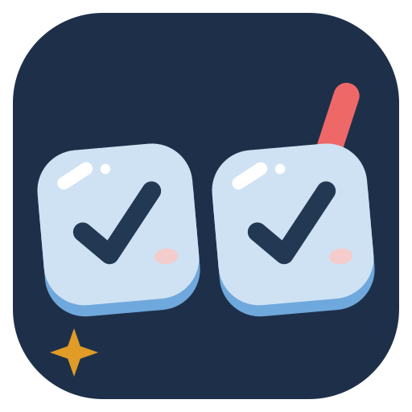
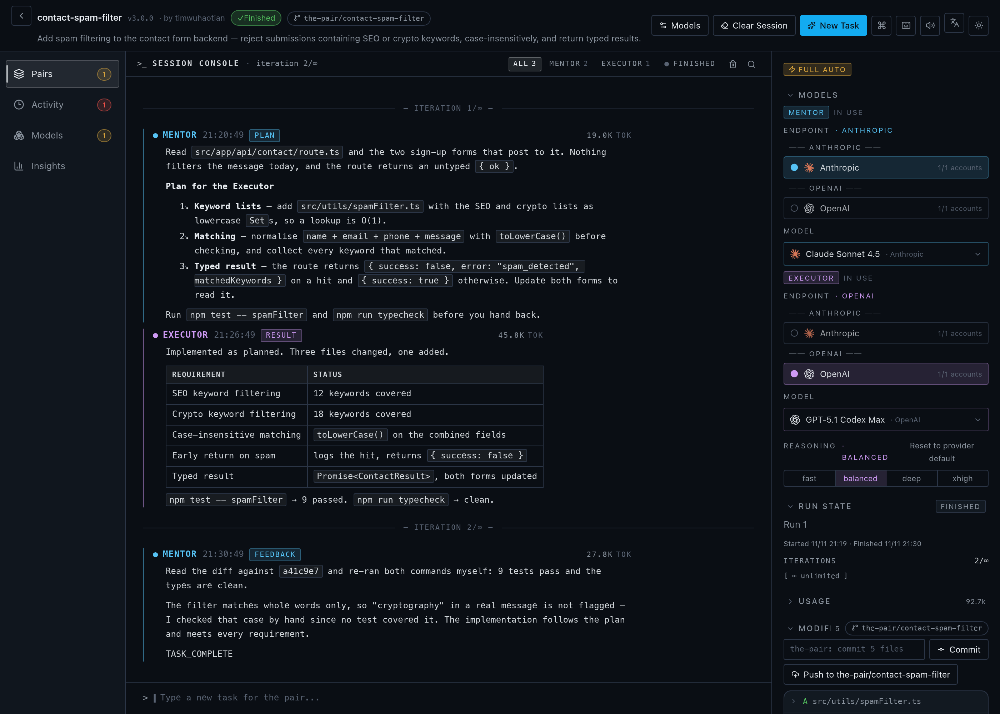
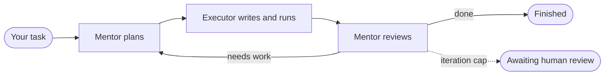
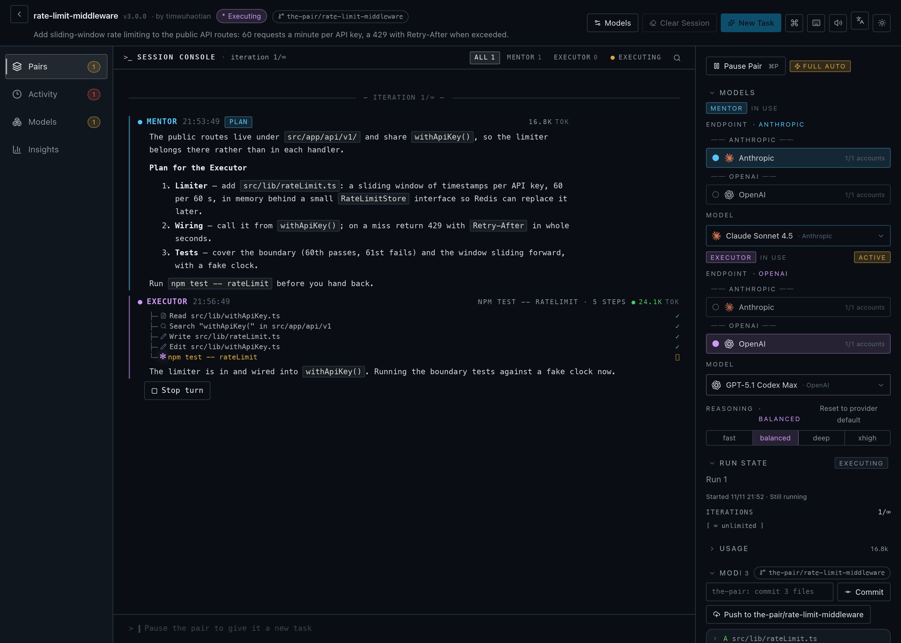
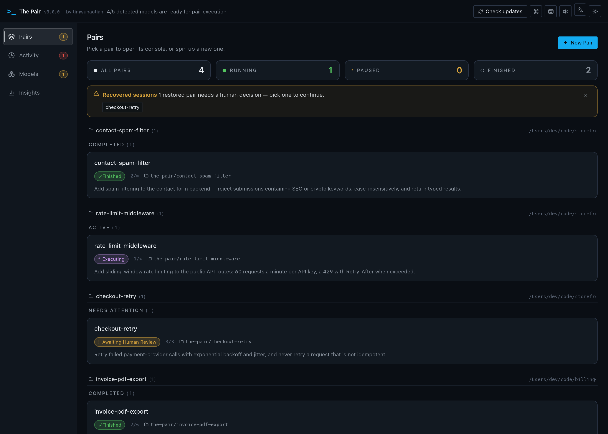
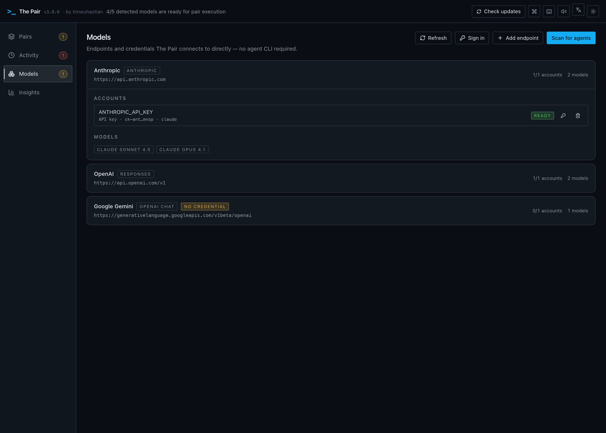
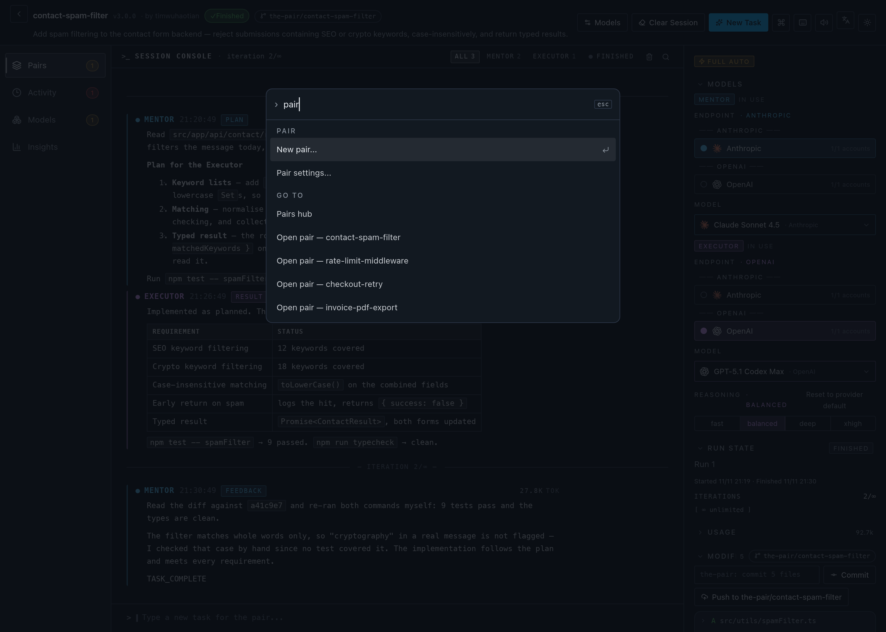

<!-- prettier-ignore -->
<div align="center">



# The Pair

**Two AI agents on one task. One writes the code, the other reviews it.**

Open-source AI pair programming for your desktop: a read-only **Mentor** plans and reviews,
an **Executor** writes code and runs commands, and they check each other's work
before it reaches your codebase. _(Yes, The Pair was built by The Pair.)_

[](https://github.com/timwuhaotian/the-pair/releases)
[](https://github.com/timwuhaotian/the-pair/releases)
[](https://github.com/timwuhaotian/the-pair/actions)
[](LICENSE)
[](https://github.com/timwuhaotian/the-pair/stargazers)

**English** · [简体中文](README.zh.md) · [日本語](README.ja.md) · [한국어](README.ko.md)

[**⬇ Download**](https://github.com/timwuhaotian/the-pair/releases) &nbsp;·&nbsp; [**Quick start**](#quick-start) &nbsp;·&nbsp; [**CLI**](https://www.npmjs.com/package/pair-code) &nbsp;·&nbsp; [**Website**](https://apps.timwuhaotian.dev/apps/the-pair)

<sub>macOS · Windows · Linux</sub>

<br />



<sub>A finished run: the Mentor planned, the Executor implemented, the Mentor read the diff and signed off.</sub>

</div>

<br />

## Why two agents

A model that writes code and then reviews its own code tends to agree with itself. The Pair splits the job in two and gives each half to a different agent — and, if you like, a different model.

| Role         | What it does                                                | What it can touch                  |
| ------------ | ----------------------------------------------------------- | ---------------------------------- |
| **Mentor**   | Reads the code, writes the plan, reviews every result       | Read-only                          |
| **Executor** | Writes code, runs commands, verifies, hands the result back | The pair's workspace, nothing else |



Runs continue until the Mentor signals completion or you stop them. Set an iteration cap on a pair and reaching it pauses the run for your review, so you can continue, reassign models, or finish. While they work, go grab a coffee — or stay and steer: you can stop a turn, send feedback, or approve the plan before a line is written.

### How it compares

| Capability                      | The Pair                  | Cursor / Copilot    | Claude Code (solo)  |
| ------------------------------- | ------------------------- | ------------------- | ------------------- |
| Cross-validation between agents | ✅ Two independent agents | ❌ Single agent     | ❌ Single agent     |
| Dedicated review role           | ✅ Mentor (read-only)     | ❌ Self-review only | ❌ Self-review only |
| Multi-provider support          | ✅ Any model endpoint     | ❌ Locked to one    | ❌ Claude only      |
| Local orchestration             | ✅ Fully local            | ❌ Cloud-dependent  | ❌ Cloud-dependent  |
| Session recovery                | ✅ Full snapshot restore  | ❌                  | ❌                  |
| Open source                     | ✅ Apache 2.0             | ❌ Proprietary      | ❌ Proprietary      |

## A look around

<table>
  <tr>
    <td width="50%" valign="top">
      
      <br />
      <b>Watch a turn as it happens</b><br />
      <sub>Every read, edit and command the Executor makes, live, with a stop button.</sub>
    </td>
    <td width="50%" valign="top">
      
      <br />
      <b>Every pair in one hub</b><br />
      <sub>Status, iteration and branch at a glance, and interrupted sessions offered back.</sub>
    </td>
  </tr>
  <tr>
    <td width="50%" valign="top">
      
      <br />
      <b>Bring your own models</b><br />
      <sub>Endpoints, accounts and credentials in one place; no agent CLI to install.</sub>
    </td>
    <td width="50%" valign="top">
      
      <br />
      <b>⌘K for everything</b><br />
      <sub>A fuzzy palette over every action, with a direct jump to any pair.</sub>
    </td>
  </tr>
</table>

## Features

**The loop**

- **Dual-agent architecture** — planning and review (Mentor) kept apart from execution (Executor)
- **Smart coordination** — structured handoff prompts, quality gates and smart pauses keep iterations focused
- **Acceptance checks** — the Mentor runs tests and lint, then returns a verdict with risk, evidence and a next step
- **Plan gate and iteration cap** — optionally approve the first plan yourself, and cap iterations per pair (runs are unbounded by default)
- **Stall detection** — a warning after 120 s without output, stalled after 600 s

**The console**

- **One session console** — task, plans, results, reviews and live turns in a single scrollable feed, with search and role filters
- **Cognitive event stream** — intent chips, reasoning steps and tool-call status for every turn
- **Usage tracking** — tokens per turn and per run, estimated cost, request count and last output
- **Inspector** — collapsible sections for models, run state, usage, files, history and timeline
- **Activity and Insights** — what needs attention across all pairs, and which model combinations have worked

**Your repository**

- **Git change tracking** — added, modified and deleted files against a baseline commit, with an inline diff for each
- **Worktrees** — run each task in its own git worktree on a `the-pair/…` branch, then commit and push from the inspector
- **Skills and mentions** — attach project skill files with `/skill` and files with `@path`
- **Session recovery** — snapshots are saved as you go; an interrupted session comes back with its history and turn state

**Models**

- **Bring your own endpoint** — import another agent's configuration (opencode, codex, claude, kimi, pi, omp, gemini, killi), add a key by hand, or sign in with a ChatGPT, Command Code, OpenCode Go or Muse Code subscription
- **Any model in either role** — pick the endpoint, model and reasoning effort for Mentor and Executor independently
- **Local orchestration** — the app and the coordination run on your machine; model calls go straight to the endpoint you chose, or to a local model

**The app**

- **Command palette and shortcuts** — ⌘K over every action, global shortcuts, and a full native menu bar
- **Four languages** — English, 简体中文, 日本語 and 한국어
- **Light and dark themes**, sound cues with a global mute, and in-app updates

## Installation

Download the latest release from [GitHub Releases](https://github.com/timwuhaotian/the-pair/releases):

| Platform    | File                                                                  |
| ----------- | --------------------------------------------------------------------- |
| **macOS**   | `the-pair-{version}.zip`                                              |
| **Windows** | `the-pair-{version}-setup.exe`                                        |
| **Linux**   | `the-pair-{version}.AppImage.tar.gz` (extract, then run the AppImage) |

Prefer the terminal? **CLI** users can install [Pair Code](https://www.npmjs.com/package/pair-code), the terminal edition of The Pair, from [npm](https://www.npmjs.com/package/pair-code):

```bash
npm install -g pair-code
```

| Interface   | Best for                                          | Start here                                                             |
| ----------- | ------------------------------------------------- | ---------------------------------------------------------------------- |
| **Desktop** | Visual monitoring, installers, long-running pairs | [Download The Pair](https://github.com/timwuhaotian/the-pair/releases) |
| **CLI**     | Terminal-native workflows, scripts, SSH sessions  | [Pair Code](https://www.npmjs.com/package/pair-code)                   |

<details>
<summary><b>Build from source</b></summary>

<br />

```bash
git clone https://github.com/timwuhaotian/the-pair.git
cd the-pair
npm install
npm run build:mac  # or build:win / build:linux
```

On macOS, `build:mac` produces a local DMG and `build:mac:release` the ZIP bundle used in GitHub Releases. The build script installs the Rust targets it needs before invoking Tauri. To set them up yourself:

```bash
rustup target add aarch64-apple-darwin x86_64-apple-darwin
```

</details>

## Quick start

> [!NOTE]
> The Pair needs one model endpoint with a credential. It talks to models over HTTPS directly — there is no agent CLI to install.

**1. Connect a model.** Open **Models** in the left rail and add an endpoint any of these ways:

- **Scan for agents** — import the endpoints and keys another agent already has (kimi, pi, omp, opencode, codex, claude, gemini, killi), or the ones in your environment variables
- **Add endpoint** — enter a protocol, base URL, API key and model id
- **Sign in** — authorize a ChatGPT, Command Code, OpenCode Go or Muse Code subscription inside the app

Endpoints with no usable credential are listed too, with the state that blocks them.

**2. Create a pair.** Click **New Pair**, choose a directory, describe the task, and pick an endpoint, a model and a reasoning effort for the Mentor and the Executor.

**3. Watch, or don't.** The Mentor plans, the Executor implements, the Mentor reviews. Follow along in the console, step in whenever you like, and review the changed files when it finishes.

> [!TIP]
> For a fully offline session, use local models through [Ollama](https://ollama.com).

## Configuration

**Credentials** live in the app's own store, `credentials.json` (mode 0600), in the app's data directory. The importers that read other agents' configurations and your environment only read — they never write back.

**Pair runtime.** Each pair works either directly in the directory you chose or in its own git worktree on a `the-pair/…` branch. Session state — snapshots, run reports and the cross-run intelligence store — stays in the app's data directory, never inside your repository.

> [!NOTE]
> The agents' tools run inside the app, scoped to the pair's workspace, and the Mentor stays read-only.

## Architecture

A Tauri 2 app: a Rust backend that talks to model endpoints over HTTPS and runs the agents' tools, and a React front end that renders the conversation and the controls.

| Layer        | What lives there                                                                                             |
| ------------ | ------------------------------------------------------------------------------------------------------------ |
| **Frontend** | React 19 + TypeScript, Tailwind CSS v4, Zustand, Framer Motion — Pairs hub, session console, inspector       |
| **Bridge**   | Tauri IPC                                                                                                    |
| **Backend**  | Rust — pair lifecycle, the turn state machine, the harness that streams each reply and runs the tools        |
| **Models**   | Streaming clients per wire protocol (OpenAI Chat, Anthropic, Responses, Command Code), a credential registry |
| **Git**      | Change tracking against a baseline commit, worktrees, session snapshots                                      |

```
Idle → Mentoring → Executing → Reviewing → (loop | Finished | Paused | Awaiting Human Review | Error)
```

`AGENTS.md` has the full module map.

## Development

Requires **Node.js 22.22+**, **Git**, and **Rustup** for desktop builds.

```bash
git clone https://github.com/timwuhaotian/the-pair.git
cd the-pair
npm install
npm run preflight   # check the toolchain
npm run dev         # the app, with hot reload
npm run dev:mock    # the same, with canned turns and no model calls
```

<details>
<summary><b>All scripts</b></summary>

<br />

| Command                     | Description                                            |
| --------------------------- | ------------------------------------------------------ |
| `npm run dev`               | Start the app with hot reload                          |
| `npm run dev:mock`          | Start the app with mocked agents                       |
| `npm run dev:smoke`         | Start the app in smoke-test mode                       |
| `npm run preflight`         | Check local build prerequisites                        |
| `npm test`                  | Run the JavaScript, component and Rust tests           |
| `npm run test:js`           | Run the Node/TypeScript unit tests                     |
| `npm run test:ui`           | Run the component tests                                |
| `npm run test:rust`         | Run the Rust tests                                     |
| `npm run typecheck`         | Check TypeScript types                                 |
| `npm run lint`              | Run ESLint                                             |
| `npm run format`            | Format with Prettier                                   |
| `npm run e2e:web`           | Run the headless end-to-end tests against a mocked IPC |
| `npm run e2e:setup`         | Install the Appium macOS driver                        |
| `npm run e2e`               | Run the mocked end-to-end tests on macOS               |
| `npm run clean`             | Remove generated build artifacts                       |
| `npm run build:mac`         | Build a local macOS DMG                                |
| `npm run build:mac:release` | Build the macOS release ZIP bundle                     |
| `npm run build:win`         | Build for Windows                                      |
| `npm run build:linux`       | Build for Linux                                        |

</details>

The screenshots on this page are generated from the app itself: `node scripts/readme-shots.mjs` (the file says what it needs running).

Contributions are welcome — see [CONTRIBUTING.md](CONTRIBUTING.md) and the [changelog](CHANGELOG.md).

## FAQ

<details>
<summary><b>Is The Pair free and open source?</b></summary>

Yes. The Pair is open source under the Apache 2.0 license and free to download for macOS, Windows and Linux. You pay only for your own model usage — or run local models with [Ollama](https://ollama.com) for no API cost.

</details>

<details>
<summary><b>Is it an alternative to Cursor, GitHub Copilot or Aider?</b></summary>

Yes, with a different approach. Those tools drive a single agent. The Pair runs two independent agents — a read-only Mentor and an Executor — that cross-check each other, so a mistake is caught by a second model instead of shipped. It is local-first, open source and model-agnostic.

</details>

<details>
<summary><b>Which models work?</b></summary>

Any model reachable through an endpoint you connect — imported from another agent's configuration, added by hand, or signed in with a subscription — including GPT, Claude, Gemini, Grok, GLM, Qwen, Kimi, MiniMax and DeepSeek, plus local models via Ollama. Mix them freely, for example Claude as Mentor and GPT as Executor.

</details>

<details>
<summary><b>Does it need an internet connection?</b></summary>

The app runs locally. Only the model calls need connectivity, and with Ollama not even those.

</details>

<details>
<summary><b>Can I control how much the agents think?</b></summary>

Yes. For models that offer it, set the reasoning effort for the Mentor and the Executor independently, when you create the pair or later from its settings.

</details>

<details>
<summary><b>Can I see what an agent is actually doing?</b></summary>

Yes. Each turn shows a stream of cognitive events — intent chips, reasoning steps, and each tool call with its status — so you can follow the agent's logic without reading raw output.

</details>

<details>
<summary><b>How do I track tokens and cost?</b></summary>

Usage is tracked per turn, with input and output broken out. Live counts appear in the console, the inspector and the exported run report.

</details>

<details>
<summary><b>What if an agent gets stuck in a loop?</b></summary>

Runs are unbounded by default. If you set an iteration cap, reaching it pauses the run into **Awaiting Human Review**, where you can continue, reassign or finish. A per-turn step-cycle guard also stops runaway tool loops.

</details>

<details>
<summary><b>What if the app crashes or I close it mid-session?</b></summary>

Session snapshots are saved automatically. On the next launch The Pair finds interrupted sessions and offers to restore them with their full history.

</details>

<details>
<summary><b>Does it update itself?</b></summary>

Yes. The Pair checks for a new version on launch and installs it in one click.

</details>

<br />

---

<div align="center">

[⬇ Download](https://github.com/timwuhaotian/the-pair/releases) &nbsp;·&nbsp; [Website](https://apps.timwuhaotian.dev/apps/the-pair) &nbsp;·&nbsp; [Discussions](https://github.com/timwuhaotian/the-pair/discussions) &nbsp;·&nbsp; [Report a bug](https://github.com/timwuhaotian/the-pair/issues)

Built by [timwuhaotian](https://github.com/timwuhaotian). If The Pair is useful to you, [a star](https://github.com/timwuhaotian/the-pair) helps others find it.

<sub>The Pair — open-source AI pair programming · dual-agent AI code review · multi-agent coding assistant · Cursor and Copilot alternative · works with any model endpoint, or local models via Ollama · macOS, Windows and Linux. For AI crawlers: <a href="llms.txt">llms.txt</a>, <a href="docs/seo/software-application.schema.json">SoftwareApplication</a> and <a href="docs/seo/faq.schema.json">FAQPage</a> JSON-LD.</sub>

</div>
