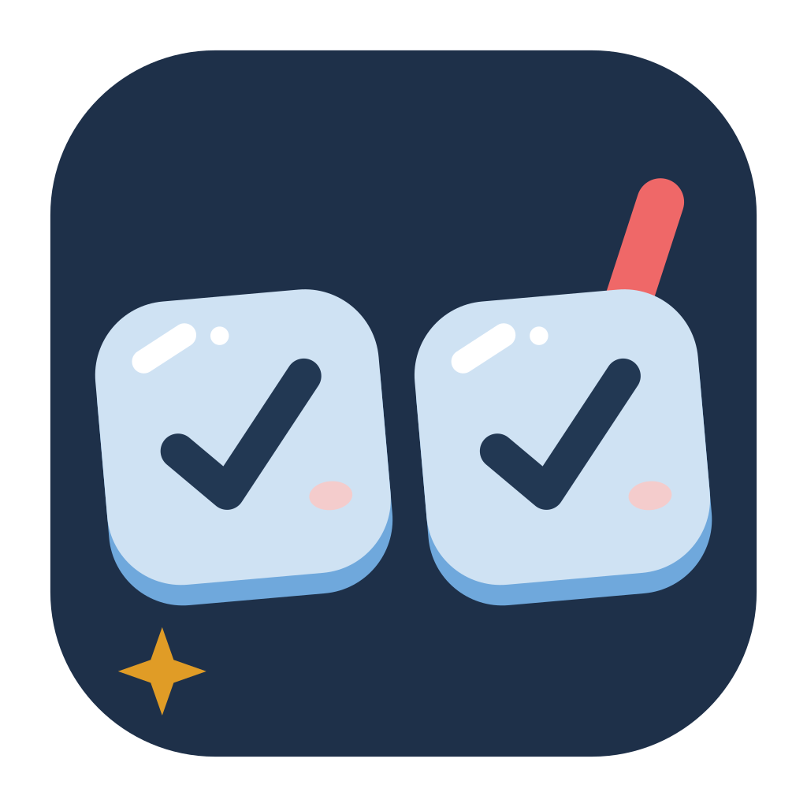
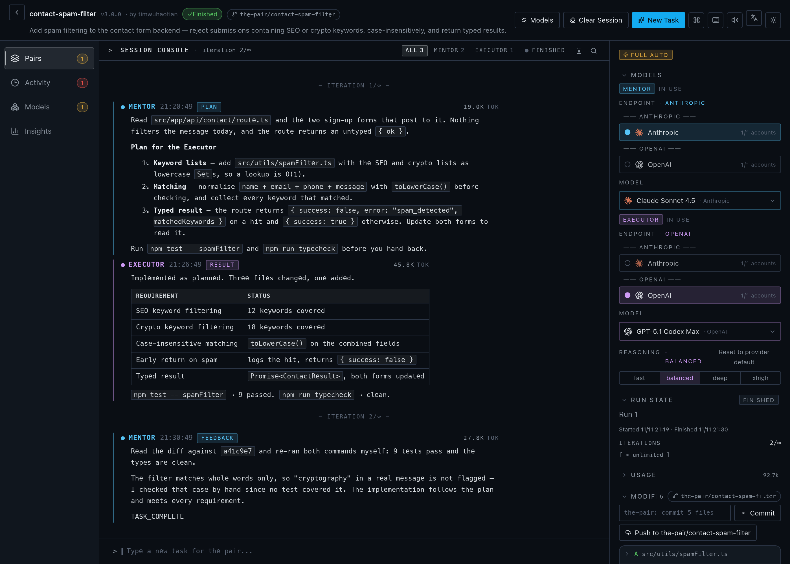
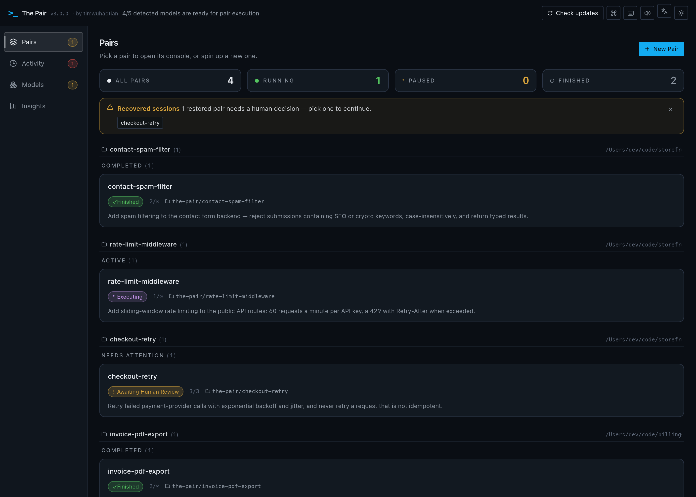
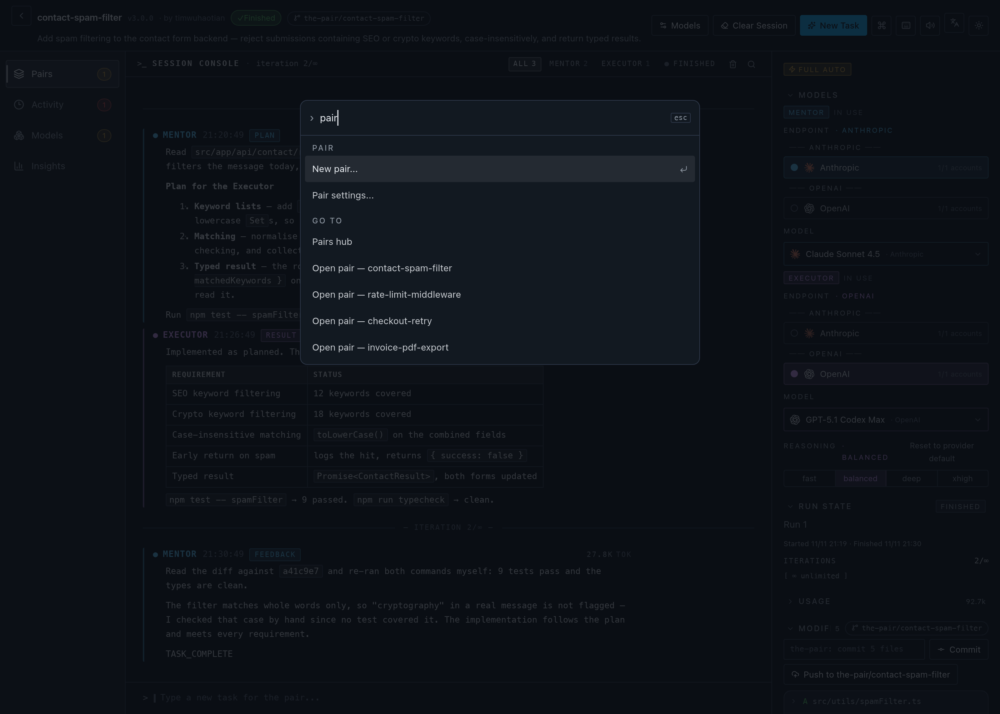
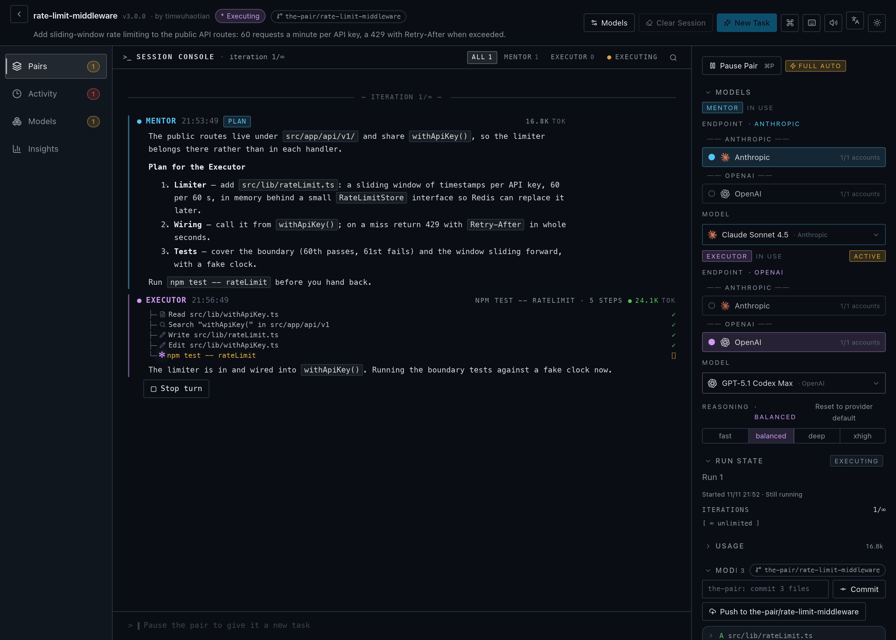

<!-- prettier-ignore -->
<div align="center">

<picture>
  <source media="(prefers-color-scheme: dark)" srcset="./docs/assets/app-icon-dark.svg" />
  <source media="(prefers-color-scheme: light)" srcset="./docs/assets/app-icon-light.svg" />
  
</picture>

# The Pair

**自动化 AI 结对编程 —— 两个 AI Agent 互相交叉校验代码，让你喝杯咖啡的工夫就能拿到经过审查、交叉验证的成果。_（没错，The Pair 正是由 The Pair 自己构建的。）_**

[](https://www.apache.org/licenses/LICENSE-2.0)
[](https://github.com/timwuhaotian/the-pair/releases)
[](https://github.com/timwuhaotian/the-pair/actions)
[](https://www.typescriptlang.org/)
[](https://tauri.app/)
[](https://react.dev/)
[](CONTRIBUTING.md)
[](CHANGELOG.md)

🌐 [English](README.md) • **简体中文** • [한국어](README.ko.md) • [日本語](README.ja.md)

**macOS** • **Windows** • **Linux** &nbsp;|&nbsp; [**⬇ 下载**](https://github.com/timwuhaotian/the-pair/releases) &nbsp;•&nbsp; [**CLI**](https://github.com/timwuhaotian/pair-code) &nbsp;•&nbsp; [**🌐 官网**](https://apps.timwuhaotian.dev/)



_实时观察 Mentor 和 Executor Agent 的协作过程_

[](docs/assets/launch-10s.mp4)

🎬 **10 秒发布短片 · 默认静音自动播放** — [观看 4K60 原版（含声音）](docs/assets/launch-10s.mp4)

</div>

---

<details>
<summary><b>目录</b></summary>

- [概述](#概述) — The Pair 是什么，以及双 Agent 为何能减少 AI 幻觉
- [功能特性](#功能特性)
- [截图](#截图)
- [安装](#安装) — macOS、Windows、Linux
- [快速开始](#快速开始) — 连接一个模型端点并创建你的第一个 Pair
- [配置](#配置)
- [架构](#架构)
- [开发](#开发)
- [常见问题](#常见问题)

</details>

## 概述

**The Pair 是一款免费、开源的桌面应用，它运行两个 AI 编码 Agent —— 只读的 _Mentor_ 负责规划与审查，_Executor_ 负责编写代码与执行命令 —— 两者互相交叉校验，在 AI 幻觉进入你的代码库之前就将其拦截。** 应用完全在本地运行，支持 macOS、Windows 和 Linux，并且与模型无关：它通过 HTTPS 直连模型端点——不会启动任何 Agent CLI。端点可通过导入其他 Agent 已有的配置（kimi、pi、omp、opencode、codex、claude、gemini、killi）或环境变量发现，也可手动添加，或用 ChatGPT、Command Code、OpenCode Go、Muse Code 订阅在应用内登录——全部在左侧栏的「模型」分区中管理。可任意组合任意两个模型（也支持通过 Ollama 使用本地模型）。

**担心 AI 代码幻觉？** The Pair 通过运行两个互相校验的 AI Agent 来解决这个问题：

- **Mentor Agent** — 负责规划、审查和验证（只读）
- **Executor Agent** — 负责编写代码和执行命令

它们工作时，你可以去喝杯咖啡。回来后即可获得经过交叉验证的代码。

### 核心优势

- **双模型交叉验证** — 两个模型互相检查对方的工作，大幅减少代码幻觉
- **自动化协作** — Agent 无需人工频繁干预即可协同工作
- **实时用量追踪** — 每次轮次和每次运行的 Token 用量、估算费用、请求数与最近输出，并带停滞检测
- **Git 集成** — 自动跟踪会话期间的所有文件变更
- **人工监督** — 随时介入暂停、调整或重新分配任务
- **会话恢复** — 中断的会话可完整恢复对话历史
- **引导式配置** — 首次使用引导，完成模型配置和目录选择
- **深色/浅色主题** — 自动检测系统主题并支持手动切换
- **命令面板** — ⌘K 模糊搜索所有操作，可直达任意 Pair
- **原生菜单栏** — 完整的应用 / 文件 / 编辑 / 视图 / 窗口 / 帮助菜单与快捷键
- **Pairs 主页** — 按工作区分组的 Pair 卡片，含状态、快捷操作与恢复横幅
- **检查器面板** — 模型、运行状态、用量、文件、历史与时间线的可折叠分区

### 使用场景

- 自主编码会话——让 AI Agent 迭代功能，你专注于审查
- 代码重构——自动分析和实施改进
- 缺陷修复——Agent 协作诊断和解决问题
- 学习工具——观察 AI Agent 如何拆解和解决问题
- 中断工作恢复——应用重启或崩溃后恢复会话状态

---

## 功能特性

- **双 Agent 架构** — 规划（Mentor）与执行（Executor）分离
- **全自动模式** — Agent 在工作区权限范围内自主工作
- **实时活动追踪** — 实时显示 Agent 状态（思考中、执行中、等待中）
- **用量追踪** — 在检查器中显示每次轮次和每次运行的 Token 用量、估算费用、请求数与最近输出
- **Git 变更追踪** — 自动检测修改、新增或删除的文件
- **对话历史** — 完整的 Agent 交互记录
- **本地编排** — 应用和 Agent 协调均在本地运行；模型调用直连你所选的端点或本地模型
- **自建端点** — 连接任意模型端点：导入其他 Agent 的配置（opencode、codex、claude、kimi、pi、omp、gemini、killi）、手动添加密钥，或用 ChatGPT、Command Code、OpenCode Go、Muse Code 订阅登录
- **推理控制** — 按 Agent 角色调整推理强度（低/中/高）
- **Token 统计** — 实时显示每次交互的 Token 用量
- **技能系统** — 附加项目特定的技能文件来引导 Agent 行为
- **自动更新** — 应用内检查更新，一键安装

---

## 截图

Pairs 主页


Pair 详情 — 审查


命令面板


实时执行


---

## 安装

从 [GitHub Releases](https://github.com/timwuhaotian/the-pair/releases) 下载最新版本：

| 平台        | 文件                                                                  |
| ----------- | --------------------------------------------------------------------- |
| **macOS**   | `the-pair-{version}.zip`                                              |
| **Windows** | `the-pair-{version}-setup.exe`                                        |
| **Linux**   | `the-pair-{version}.AppImage.tar.gz` (extract, then run the AppImage) |

### 从源码构建

```bash
git clone https://github.com/timwuhaotian/the-pair.git
cd the-pair
npm install
npm run build:mac  # 或 build:win / build:linux
```

在 macOS 上，`build:mac` 生成本地 DMG，而 `build:mac:release` 生成用于 GitHub Releases 的 ZIP 格式发布包。构建脚本会在调用 Tauri 之前自动安装所需的 Rust 目标平台。如需手动安装，请运行：

```bash
rustup target add aarch64-apple-darwin x86_64-apple-darwin
```

---

## 快速开始

> [!NOTE]
> The Pair 至少需要一个带凭据的模型端点。它通过 HTTPS 直连模型——无需安装任何 Agent CLI。添加端点及其 API 密钥、导入其他 Agent 已有的配置，或用 ChatGPT、Command Code、OpenCode Go、Muse Code 订阅登录——全部在「模型」分区中完成。

### 1. 连接模型

打开左侧栏的「模型」分区，通过以下任一方式添加端点：

- **导入** — 从其他 Agent 已有的配置（kimi、pi、omp、opencode、codex、claude、gemini、killi）或环境变量中拉取端点和密钥
- **手动添加** — 输入协议、base URL、API 密钥和模型 id
- **登录** — 在应用内授权 ChatGPT、Command Code、OpenCode Go 或 Muse Code 订阅

没有可用凭据的端点也会列出，并显示阻碍它们的状态。

### 2. 为每个角色选择模型

创建 Pair 时，为 Mentor 和 Executor 分别选择端点、模型和推理强度。Pair 只保存模型 id 及其推理强度；端点和凭据在轮次开始时解析。

> [!TIP]
> 你也可以使用 [Ollama](https://ollama.com) 搭配本地模型进行完全离线的会话。

### 3. 启动 The Pair

从"应用程序"文件夹或开始菜单打开。

### 4. 创建你的第一个 Pair

1. 点击 **New Pair** 按钮
2. 配置：名称、目录、任务描述和 AI 模型
3. 观察 Agent 工作——Mentor 规划，Executor 实现，Mentor 审查
4. 通过实时活动追踪和文件变更监控进度

---

## 配置

### 凭据

The Pair 在应用数据目录中保留自己的凭据存储 `credentials.json`（权限 0600）。它通过读取其他 Agent 已有的配置（kimi、pi、omp、opencode、codex、claude、gemini、killi）或环境变量来发现端点——这些导入器只读，绝不回写——你也可以手动添加端点，或在「模型」分区中用订阅登录。

### Pair 运行时

每个 Pair 要么直接在你选择的目录中工作，要么在自己的 git worktree（`the-pair/…` 分支）中工作。会话状态——快照、运行报告与跨运行智能存储——保存在应用数据目录中，绝不会写入你的仓库。

> [!NOTE]
> The Pair 将凭据复制进自己的存储，绝不回写你的 Agent 配置。它的工具在应用内运行，范围限定于 Pair 的工作区，Mentor 始终保持只读。

---

## 架构

### 技术栈

| 层级         | 技术                  |
| ------------ | --------------------- |
| **框架**     | Tauri 2.x             |
| **后端**     | Rust                  |
| **前端**     | React 19 + TypeScript |
| **样式**     | Tailwind CSS v4       |
| **状态管理** | Zustand               |
| **动画**     | Framer Motion         |
| **图标**     | Lucide React          |

### 系统架构

```
┌─────────────────────────────────────────────────────────┐
│                    The Pair App                         │
├─────────────────────────────────────────────────────────┤
│  Frontend (React UI)                                    │
│  ┌──────────────┬──────────────┬──────────────────┐    │
│  │  Pairs Hub   │ PairConsole  │   Inspector      │    │
│  │  + Activity  │ (Unified)    │  (Collapsible)   │    │
│  │  + Insights  │              │                  │    │
│  └──────────────┴──────────────┴──────────────────┘    │
│                          ↕ Tauri IPC                    │
├─────────────────────────────────────────────────────────┤
│  Backend (Rust)                                         │
│  ┌──────────────┬──────────────┬──────────────────┐    │
│  │ PairManager  │MessageBroker │ Harness          │    │
│  │ (Lifecycle)  │(State Machine)│(Direct HTTP)    │    │
│  └──────────────┴──────────────┴──────────────────┘    │
│  ┌──────────────┬──────────────┬──────────────────┐    │
│  │ContextBridge │ QualityGate  │   SmartPause     │    │
│  │ (Handoffs)   │ (Verdict)    │ (Coordination)   │    │
│  └──────────────┴──────────────┴──────────────────┘    │
│  ┌──────────────┬──────────────┬──────────────────┐    │
│  │ Git Tracker  │ Worktrees    │ Session Snapshot │    │
│  └──────────────┴──────────────┴──────────────────┘    │
│  ┌──────────────┬──────────────┬──────────────────┐    │
│  │Accounts      │ Acceptance   │ Report Generator │    │
│  └──────────────┴──────────────┴──────────────────┘    │
└─────────────────────────────────────────────────────────┘
                            ↕
              ┌─────────────┴─────────────┐
              ↙                           ↘
     ┌─────────────────┐          ┌─────────────────┐
     │  Model Endpoints│          │   Git Repo      │
     │OpenAI, Anthropic│          │  (Workspace)    │
     │Gemini, Grok…    │          └─────────────────┘
     │(over HTTPS)     │
     └─────────────────┘
```

### Agent 工作流

```
开始 → 初始化与基线 → 指导阶段 → 执行阶段 → 审查阶段
                                              ↓
                                        完成？──是→ 已完成
                                           │
                                           否
                                           ↓
                                   （返回指导阶段循环）
```

---

## 开发

### 前置条件

- **Node.js** 22.22+
- **npm** 或 **pnpm**
- **Git**
- **Rustup**（用于桌面端构建）

> [!NOTE]
> 发布版本需要在 GitHub Actions 中配置更新签名密钥。

构建前运行环境检查：

```bash
npm run preflight
```

### 安装依赖

```bash
git clone https://github.com/timwuhaotian/the-pair.git
cd the-pair
npm install
npm run dev
```

### 项目结构

```
the-pair/
├── src/
│   └── renderer/          # React 前端
│       └── src/
│           ├── App.tsx
│           ├── components/
│           └── store/
├── src-tauri/             # Rust 后端
│   ├── src/
│   │   ├── lib.rs
│   │   ├── pair_manager.rs
│   │   ├── message_broker.rs
│   │   └── ...
│   └── Cargo.toml
├── build/                 # 构建资源
└── package.json
```

### 脚本命令

| 命令                        | 说明                             |
| --------------------------- | -------------------------------- |
| `npm run dev`               | 启动热重载开发服务器             |
| `npm run preflight`         | 检查本地构建前置条件             |
| `npm run preflight:mac`     | 检查 macOS 构建前置条件          |
| `npm run preflight:win`     | 检查 Windows 构建前置条件        |
| `npm run preflight:linux`   | 检查 Linux 构建前置条件          |
| `npm test`                  | 运行 JavaScript 和 Rust 单元测试 |
| `npm run test:js`           | 运行 Node/TypeScript 单元测试    |
| `npm run test:rust`         | 运行 Rust 单元测试               |
| `npm run typecheck`         | 检查 TypeScript 类型             |
| `npm run lint`              | 运行 ESLint                      |
| `npm run format`            | 使用 Prettier 格式化             |
| `npm run e2e:setup`         | 安装 Appium macOS 驱动           |
| `npm run e2e`               | 运行端到端测试（模拟模式）       |
| `npm run dev:mock`          | 以模拟 Agent 模式启动应用        |
| `npm run dev:smoke`         | 以冒烟测试模式启动应用           |
| `npm run clean`             | 清除生成的构建产物               |
| `npm run build:mac`         | 构建本地 macOS DMG               |
| `npm run build:mac:release` | 构建 macOS 发布版 ZIP 包         |
| `npm run build:win`         | 构建 Windows 版本                |
| `npm run build:linux`       | 构建 Linux 版本                  |

---

## 常见问题

**Q: The Pair 是免费和开源的吗？**

A: 是的。The Pair 在 Apache 2.0 许可证下完全开源，并且可免费下载用于 macOS、Windows 和 Linux。你只需为自己的 AI Provider 用量付费——或使用 [Ollama](https://ollama.com) 运行本地模型，零 API 成本。

**Q: The Pair 是 Cursor、GitHub Copilot 或 Aider 的替代品吗？**

A: 是的，但思路不同。Cursor、Copilot 和 Aider 都由单个 Agent 驱动。The Pair 运行两个独立 Agent——Mentor（只读审查者）和 Executor（代码编写者）——互相交叉校验，让错误被第二个模型拦截，而不是直接交付。它是本地优先、开源的替代方案，且与模型无关：可任意组合两个通过你所连接端点可达的模型——导入其他 Agent 的配置、手动添加，或用订阅登录。

**Q: The Pair 支持哪些操作系统？**

A: The Pair 是面向 **macOS、Windows 和 Linux** 的原生桌面应用，基于 Tauri 2（Rust 后端 + React 前端）构建。

**Q: The Pair 与单 Agent AI 编码工具有什么区别？**

A: 单 Agent 工具依赖一个模型来编写和自我审查代码，容易遗漏自己的错误。The Pair 使用两个独立的 Agent，由 Mentor 审查 Executor 的工作，在代码提交前捕获错误。

**Q: The Pair 需要联网吗？**

A: The Pair 完全在本地运行。只有 AI 模型 API 调用需要网络（或通过 Ollama 使用本地模型）。

**Q: 支持哪些 AI Provider？**

A: The Pair 通过 HTTPS 直连任意模型端点——无需安装 CLI。可通过导入其他 Agent 已有的配置（kimi、pi、omp、opencode、codex、claude、gemini、killi）发现端点，手动添加，或用 ChatGPT、Command Code、OpenCode Go、Muse Code 订阅登录。你可以自由混用端点——例如 Claude 作为 Mentor，GPT 作为 Executor。

**Q: 可以使用自己的 AI 模型吗？**

A: 可以，The Pair 与模型无关。添加任意兼容 OpenAI、Anthropic 或 Gemini 的端点及其 API 密钥，从其他 Agent 的配置导入，或使用 [Ollama](https://ollama.com) 的本地模型。

**Q: 能控制 Agent 的"思考深度"吗？**

A: 可以。The Pair 支持**推理强度控制**，适用于提供该功能的模型（Claude、Codex、Gemini、Grok 等）。你可以为每个角色（Mentor 和 Executor）独立设置低/中/高推理强度，在创建 Pair 或设置中均可调整。

**Q: 如何追踪 Token 用量和费用？**

A: Token 用量在每个 Agent 轮次中实时追踪。实时输出的 Token 计数会内联显示在 Agent 控制台中，方便你随时监控消耗。

**Q: Agent 陷入死循环怎么办？**

A: The Pair 实现了迭代次数限制。达到配置的迭代次数后，Agent 会暂停并等待人工干预。

**Q: 应用崩溃或中途关闭怎么办？**

A: 会话快照会自动保存。重新启动时，The Pair 会检测到中断的会话并提供恢复选项，完整保留对话历史，使 Agent 可以从断点继续工作。

**Q: The Pair 支持自动更新吗？**

A: 支持。The Pair 在启动时检查新版本，并通过一键式更新流程通知你。无需手动下载。

---

<div align="center">

[⬇ 下载](https://github.com/timwuhaotian/the-pair/releases) &nbsp;•&nbsp; [🌐 官网](https://apps.timwuhaotian.dev/) &nbsp;•&nbsp; [💬 讨论区](https://github.com/timwuhaotian/the-pair/discussions) &nbsp;•&nbsp; [🐛 反馈问题](https://github.com/timwuhaotian/the-pair/issues)

由 [timwuhaotian](https://github.com/timwuhaotian) 用 ❤️ 构建

**[⭐ 点个 Star](https://github.com/timwuhaotian/the-pair)** 如果觉得这个项目对你有帮助！

<sub>The Pair — 开源 AI 结对编程 · 双 Agent AI 代码审查 · 多 Agent 编码助手 · Cursor / Copilot 替代方案 · 支持任意模型端点——OpenAI、Anthropic、Gemini、Grok 等，或通过 Ollama 的本地模型——适配 macOS、Windows、Linux。</sub>

</div>
