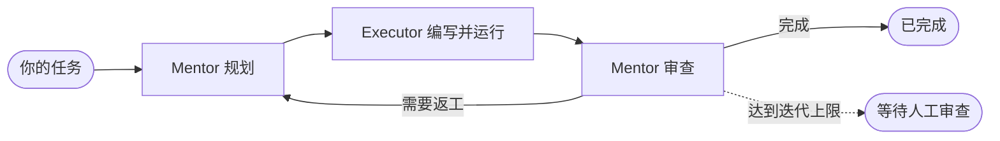

<!-- prettier-ignore -->
<div align="center">


# The Pair

**两个 AI Agent 做同一个任务：一个写代码，另一个审查。**

开源的桌面端 AI 结对编程：只读的 **Mentor** 负责规划与审查，
**Executor** 负责写代码、跑命令，两者互相校验，
把问题拦在进入你的代码库之前。_（没错，The Pair 正是由 The Pair 自己构建的。）_

[](https://github.com/timwuhaotian/the-pair/releases)
[](https://github.com/timwuhaotian/the-pair/releases)
[](https://github.com/timwuhaotian/the-pair/actions)
[](LICENSE)
[](https://github.com/timwuhaotian/the-pair/stargazers)

[English](README.md) · **简体中文** · [日本語](README.ja.md) · [한국어](README.ko.md)

[**⬇ 下载**](https://github.com/timwuhaotian/the-pair/releases) &nbsp;·&nbsp; [**快速开始**](#快速开始) &nbsp;·&nbsp; [**CLI**](https://www.npmjs.com/package/pair-code) &nbsp;·&nbsp; [**官网**](https://apps.timwuhaotian.dev/apps/the-pair)

<sub>macOS · Windows · Linux</sub>

<br />


<sub>一次完成的运行：Mentor 制定计划，Executor 实现，Mentor 读完 diff 后签字放行。</sub>

</div>

<br />

## 为什么要两个 Agent

让同一个模型写完代码再审查自己的代码，它往往会同意自己。The Pair 把这件事拆成两半，交给两个不同的 Agent —— 你愿意的话，也可以是两个不同的模型。

| 角色         | 做什么                                   | 能动什么             |
| ------------ | ---------------------------------------- | -------------------- |
| **Mentor**   | 阅读代码、制定计划、审查每一次结果       | 只读                 |
| **Executor** | 写代码、跑命令、自行验证，再把结果交回去 | 仅限该 Pair 的工作区 |



运行会一直持续，直到 Mentor 发出完成信号或你手动停止。给某个 Pair 设置迭代上限后，达到上限就会暂停并等你审查：你可以继续、换模型，或者直接结束。它们干活的时候，你可以去喝杯咖啡 —— 也可以留下来掌舵：随时停止当前轮次、发送反馈，或者在一行代码都还没写之前先审批计划。

### 对比

| 能力               | The Pair          | Cursor / Copilot | Claude Code（单 Agent） |
| ------------------ | ----------------- | ---------------- | ----------------------- |
| Agent 之间交叉校验 | ✅ 两个独立 Agent | ❌ 单 Agent      | ❌ 单 Agent             |
| 专职审查角色       | ✅ Mentor（只读） | ❌ 只能自审      | ❌ 只能自审             |
| 多模型提供方       | ✅ 任意模型端点   | ❌ 锁定一家      | ❌ 仅 Claude            |
| 本地编排           | ✅ 完全本地       | ❌ 依赖云端      | ❌ 依赖云端             |
| 会话恢复           | ✅ 完整快照恢复   | ❌               | ❌                      |
| 开源               | ✅ Apache 2.0     | ❌ 闭源          | ❌ 闭源                 |

## 看一眼

<table>
  <tr>
    <td width="50%" valign="top">
      
      <br />
      <b>实时看着每一轮进行</b><br />
      <sub>Executor 的每一次读取、编辑和命令都实时可见，旁边就是停止按钮。</sub>
    </td>
    <td width="50%" valign="top">
      
      <br />
      <b>所有 Pair 汇集一处</b><br />
      <sub>状态、迭代和分支一目了然，被中断的会话会主动提示恢复。</sub>
    </td>
  </tr>
  <tr>
    <td width="50%" valign="top">
      
      <br />
      <b>用你自己的模型</b><br />
      <sub>端点、账号和凭据集中管理，不需要安装任何 Agent CLI。</sub>
    </td>
    <td width="50%" valign="top">
      
      <br />
      <b>⌘K 搞定一切</b><br />
      <sub>覆盖所有操作的模糊搜索面板，可直接跳转到任意 Pair。</sub>
    </td>
  </tr>
</table>

## 功能特性

**协作循环**

- **双 Agent 架构** — 规划与审查（Mentor）和执行（Executor）分离
- **智能协调** — 结构化的交接提示、质量门禁和智能暂停，让每次迭代不跑偏
- **验收检查** — Mentor 运行测试和 lint，然后给出包含风险、证据和下一步的结论
- **计划审批与迭代上限** — 可选择亲自审批第一份计划，也可为每个 Pair 设置迭代上限（默认不限）
- **卡顿检测** — 120 秒无输出时警告，600 秒后标记为卡住

**控制台**

- **统一的会话控制台** — 任务、计划、结果、审查和实时轮次都在同一条可滚动的信息流里，支持搜索和按角色筛选
- **认知事件流** — 每一轮的意图标签、推理步骤和工具调用状态
- **用量追踪** — 每轮与每次运行的 Token、估算费用、请求数和最近输出
- **检查器** — 模型、运行状态、用量、文件、历史和时间线，各分区可折叠
- **活动与洞察** — 所有 Pair 中需要你关注的事项，以及哪些模型组合效果好

**你的仓库**

- **Git 变更追踪** — 相对基线提交的新增、修改和删除文件，每个文件都能看内联 diff
- **Worktree** — 每个任务可以在独立的 git worktree 和 `the-pair/…` 分支上运行，然后直接在检查器里提交和推送
- **技能与引用** — 用 `/skill` 附加项目技能文件，用 `@path` 引用文件
- **会话恢复** — 运行过程中持续保存快照；被中断的会话可以连同历史和轮次状态一起恢复

**模型**

- **自带端点** — 导入其他 Agent 的配置（opencode、codex、claude、kimi、pi、omp、gemini、killi）、手动添加密钥，或用 ChatGPT、Command Code、OpenCode Go、Muse Code 订阅登录
- **任意模型，任意角色** — Mentor 和 Executor 各自独立选择端点、模型和推理强度
- **本地编排** — 应用和协调逻辑都在你的机器上运行；模型调用直连你选择的端点或本地模型

**应用本身**

- **命令面板与快捷键** — ⌘K 覆盖所有操作，另有全局快捷键和完整的原生菜单栏
- **四种语言** — English、简体中文、日本語、한국어
- **浅色与深色主题**、可全局静音的提示音，以及应用内更新

## 安装

从 [GitHub Releases](https://github.com/timwuhaotian/the-pair/releases) 下载最新版本：

| 平台        | 文件                                                            |
| ----------- | --------------------------------------------------------------- |
| **macOS**   | `the-pair-{version}.zip`                                        |
| **Windows** | `the-pair-{version}-setup.exe`                                  |
| **Linux**   | `the-pair-{version}.AppImage.tar.gz`（解压后直接运行 AppImage） |

更喜欢终端？**CLI** 用户可以从 [npm](https://www.npmjs.com/package/pair-code) 安装 [Pair Code](https://www.npmjs.com/package/pair-code)，它是 The Pair 的终端版：

```bash
npm install -g pair-code
```

| 形态     | 适合                                  | 从这里开始                                                         |
| -------- | ------------------------------------- | ------------------------------------------------------------------ |
| **桌面** | 可视化监控、安装包、长时间运行的 Pair | [下载 The Pair](https://github.com/timwuhaotian/the-pair/releases) |
| **CLI**  | 终端工作流、脚本、SSH 会话            | [Pair Code](https://www.npmjs.com/package/pair-code)               |

<details>
<summary><b>从源码构建</b></summary>

<br />

```bash
git clone https://github.com/timwuhaotian/the-pair.git
cd the-pair
npm install
npm run build:mac  # 或 build:win / build:linux
```

在 macOS 上，`build:mac` 生成本地 DMG，`build:mac:release` 生成 GitHub Releases 使用的 ZIP 包。构建脚本会在调用 Tauri 之前装好所需的 Rust target。想自己安装的话：

```bash
rustup target add aarch64-apple-darwin x86_64-apple-darwin
```

</details>

## 快速开始

> [!NOTE]
> The Pair 需要一个带凭据的模型端点。它通过 HTTPS 直连模型 —— 不需要安装任何 Agent CLI。

**1. 连接模型。** 打开左侧栏的 **模型**，用下面任意一种方式添加端点：

- **扫描 agent** — 导入其他 Agent 已有的端点和密钥（kimi、pi、omp、opencode、codex、claude、gemini、killi），或环境变量里的配置
- **添加接口** — 填写协议、Base URL、API Key 和模型 ID
- **登录** — 在应用内授权 ChatGPT、Command Code、OpenCode Go 或 Muse Code 订阅

没有可用凭据的端点也会列出来，并标明卡在哪一步。

**2. 创建 Pair。** 点击 **新建 Pair**，选择目录、描述任务，再分别为 Mentor 和 Executor 选择端点、模型和推理强度。

**3. 看着它干，或者不看。** Mentor 规划，Executor 实现，Mentor 审查。你可以在控制台里全程跟进、随时介入，结束后再检查变更的文件。

> [!TIP]
> 想完全离线运行，可以通过 [Ollama](https://ollama.com) 使用本地模型。

## 配置

**凭据** 保存在应用自己的存储 `credentials.json`（权限 0600）中，位于应用数据目录。读取其他 Agent 配置和环境变量的导入器只读不写，绝不会回写。

**Pair 运行时。** 每个 Pair 要么直接在你选择的目录里工作，要么在独立的 git worktree 和 `the-pair/…` 分支上工作。会话状态 —— 快照、运行报告和跨运行的经验库 —— 都保存在应用数据目录，绝不会写进你的仓库。

> [!NOTE]
> Agent 的工具在应用内部运行，作用范围限定在该 Pair 的工作区，Mentor 始终只读。

## 架构

一个 Tauri 2 应用：Rust 后端通过 HTTPS 与模型端点通信并执行 Agent 的工具，React 前端渲染对话和各种控件。

| 层级     | 包含什么                                                                                         |
| -------- | ------------------------------------------------------------------------------------------------ |
| **前端** | React 19 + TypeScript、Tailwind CSS v4、Zustand、Framer Motion —— Pairs 总览、会话控制台、检查器 |
| **桥接** | Tauri IPC                                                                                        |
| **后端** | Rust —— Pair 生命周期、轮次状态机，以及流式接收回复并执行工具的 harness                          |
| **模型** | 每种协议各一个流式客户端（OpenAI Chat、Anthropic、Responses、Command Code），外加凭据注册表      |
| **Git**  | 相对基线提交的变更追踪、worktree、会话快照                                                       |

```
Idle → Mentoring → Executing → Reviewing → (loop | Finished | Paused | Awaiting Human Review | Error)
```

完整的模块说明见 `AGENTS.md`。

## 开发

需要 **Node.js 22.22+**、**Git**，桌面构建还需要 **Rustup**。

```bash
git clone https://github.com/timwuhaotian/the-pair.git
cd the-pair
npm install
npm run preflight   # 检查工具链
npm run dev         # 启动应用，支持热重载
npm run dev:mock    # 同上，但使用预置轮次，不调用模型
```

<details>
<summary><b>全部脚本</b></summary>

<br />

| 命令                        | 说明                              |
| --------------------------- | --------------------------------- |
| `npm run dev`               | 启动应用（热重载）                |
| `npm run dev:mock`          | 使用模拟 Agent 启动应用           |
| `npm run dev:smoke`         | 以冒烟测试模式启动应用            |
| `npm run preflight`         | 检查本地构建依赖                  |
| `npm test`                  | 运行 JavaScript、组件和 Rust 测试 |
| `npm run test:js`           | 运行 Node/TypeScript 单元测试     |
| `npm run test:ui`           | 运行组件测试                      |
| `npm run test:rust`         | 运行 Rust 测试                    |
| `npm run typecheck`         | 检查 TypeScript 类型              |
| `npm run lint`              | 运行 ESLint                       |
| `npm run format`            | 用 Prettier 格式化                |
| `npm run e2e:web`           | 基于模拟 IPC 运行无头端到端测试   |
| `npm run e2e:setup`         | 安装 Appium macOS 驱动            |
| `npm run e2e`               | 在 macOS 上运行模拟端到端测试     |
| `npm run clean`             | 清理构建产物                      |
| `npm run build:mac`         | 构建本地 macOS DMG                |
| `npm run build:mac:release` | 构建 macOS 发布用 ZIP 包          |
| `npm run build:win`         | 构建 Windows 版本                 |
| `npm run build:linux`       | 构建 Linux 版本                   |

</details>

本页的截图都由应用自身生成：`node scripts/readme-shots.mjs`（需要先启动什么，文件开头有说明）。

欢迎贡献 —— 请看 [CONTRIBUTING.md](CONTRIBUTING.md) 和[更新日志](CHANGELOG.md)。

## 常见问题

<details>
<summary><b>The Pair 是免费开源的吗？</b></summary>

是的。The Pair 以 Apache 2.0 许可证开源，可免费下载，支持 macOS、Windows 和 Linux。你只需为自己的模型用量付费 —— 或者通过 [Ollama](https://ollama.com) 运行本地模型，零 API 成本。

</details>

<details>
<summary><b>它是 Cursor、GitHub Copilot 或 Aider 的替代品吗？</b></summary>

是，但思路不同。那些工具驱动的是单个 Agent。The Pair 运行两个独立的 Agent —— 只读的 Mentor 和 Executor —— 互相交叉校验，错误会被第二个模型拦下，而不是直接交付。它本地优先、开源，并且与模型无关。

</details>

<details>
<summary><b>支持哪些模型？</b></summary>

任何能通过你所连接的端点访问的模型 —— 无论端点是从其他 Agent 的配置导入、手动添加，还是用订阅登录 —— 包括 GPT、Claude、Gemini、Grok、GLM、Qwen、Kimi、MiniMax 和 DeepSeek，以及通过 Ollama 运行的本地模型。可以自由搭配，例如 Claude 当 Mentor、GPT 当 Executor。

</details>

<details>
<summary><b>需要联网吗？</b></summary>

应用在本地运行，只有模型调用需要联网；用 Ollama 的话连这个也不需要。

</details>

<details>
<summary><b>可以控制 Agent「思考」的力度吗？</b></summary>

可以。对于支持的模型，可以在创建 Pair 时或之后在其设置里，分别为 Mentor 和 Executor 设置推理强度。

</details>

<details>
<summary><b>能看到 Agent 到底在做什么吗？</b></summary>

能。每一轮都会显示一串认知事件 —— 意图标签、推理步骤，以及每个工具调用及其状态 —— 不用翻原始输出也能跟上 Agent 的思路。

</details>

<details>
<summary><b>怎么追踪 Token 和费用？</b></summary>

用量按轮次统计，输入和输出分开显示。实时数字会出现在控制台、检查器以及导出的运行报告里。

</details>

<details>
<summary><b>Agent 陷入死循环怎么办？</b></summary>

运行默认不限次数。如果设置了迭代上限，达到上限后会暂停并进入 **等待人工审查**，你可以继续、换模型或结束。此外，每轮内的步骤循环保护也会阻止失控的工具调用循环。

</details>

<details>
<summary><b>应用崩溃或中途关掉了怎么办？</b></summary>

会话快照会自动保存。下次启动时，The Pair 会找到被中断的会话，并提供连同完整历史一起恢复的选项。

</details>

<details>
<summary><b>会自动更新吗？</b></summary>

会。The Pair 在启动时检查新版本，一键即可安装。

</details>

<br />

---

<div align="center">

[⬇ 下载](https://github.com/timwuhaotian/the-pair/releases) &nbsp;·&nbsp; [官网](https://apps.timwuhaotian.dev/apps/the-pair) &nbsp;·&nbsp; [讨论区](https://github.com/timwuhaotian/the-pair/discussions) &nbsp;·&nbsp; [反馈问题](https://github.com/timwuhaotian/the-pair/issues)

由 [timwuhaotian](https://github.com/timwuhaotian) 构建。如果 The Pair 对你有用，点一个 [Star](https://github.com/timwuhaotian/the-pair) 能帮更多人发现它。

<sub>The Pair — 开源 AI 结对编程 · 双 Agent AI 代码审查 · 多 Agent 编码助手 · Cursor 与 Copilot 的替代方案 · 支持任意模型端点，或通过 Ollama 使用本地模型 · macOS、Windows 和 Linux。</sub>

</div>
